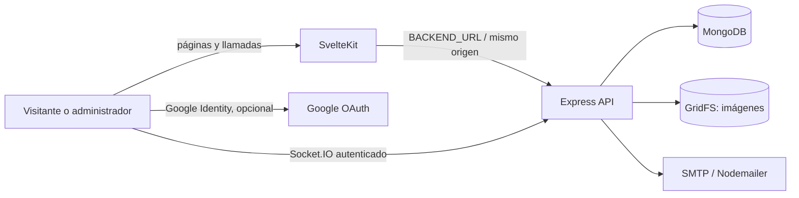
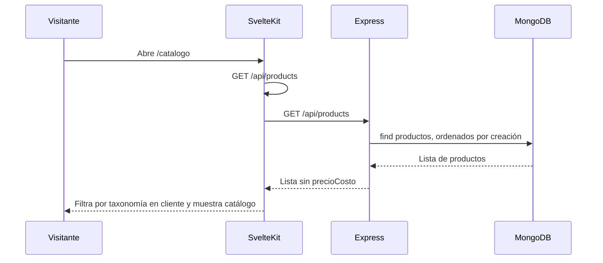
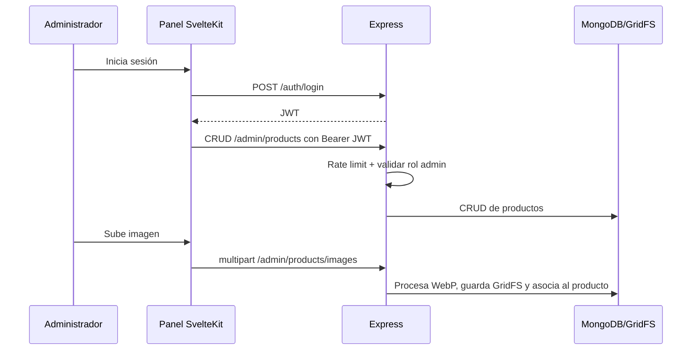
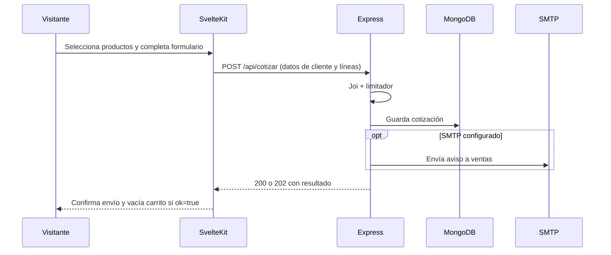

# Auditoría técnica de VGV WEB

**Fecha de revisión:** 23 de octubre de 2026
**Alcance:** lectura del código y configuración versionados, ejecución de pruebas locales existentes y lint del frontend. No se modificó el código de la aplicación.

## 1. Resumen ejecutivo

VGV WEB es una aplicación funcional para **catálogo digital y solicitudes de cotización**: los visitantes consultan productos, mantienen una lista temporal en el navegador y envían una solicitud que queda registrada en MongoDB y se notifica por correo cuando SMTP está configurado. El panel administrativo permite gestionar productos, imágenes, relaciones entre productos y estados de cotizaciones.

No es actualmente un ecommerce transaccional: no se encontraron precios de venta, órdenes de compra, reservas de stock, integración de pago, despacho ni confirmación de compra. El nombre de la ruta `/checkout` no cambia ese flujo; la interfaz y el backend la implementan como envío de cotización.

La arquitectura existente es adecuada como monolito pequeño: SvelteKit consume una API Express, MongoDB/Mongoose conserva productos y cotizaciones, GridFS almacena imágenes y Nodemailer gestiona correo. No se encontró una razón técnica que justifique reescribirla o dividirla en microservicios.

### Decisiones que bloquean o condicionan una publicación confiable

1. **No activar `AUTO_SYNC_SEED=true` sobre datos administrados sin corregir o aceptar la semántica actual.** El despliegue documentado recomienda activarlo, pero el sincronizador sobrescribe en MongoDB los campos del seed para cada producto coincidente, incluidos costo, stock, estado y variantes. La pérdida no se reprodujo contra una base real; se deduce directamente del código.
2. **Evitar que una caída del backend parezca un catálogo válido.** La API SvelteKit sustituye errores de conexión por un listado de productos de muestra y responde con éxito. Un usuario puede ver datos obsoletos o de demostración sin indicación de degradación.
3. **Confirmar el modelo comercial antes de reemplazar el sitio legacy.** El flujo verificado es de cotización. La plataforma no ofrece compra y pago en línea.
4. **Resolver el estado de las cuentas de cliente.** La interfaz y controladores existen, pero Express responde 404 a `/api/clientes`; solo continúa operativo el checkout de invitado.
5. **Verificar respaldos/restauración, variables privadas, SMTP y orígenes de producción en el entorno real.** No se inspeccionaron credenciales ni se hicieron llamadas a producción.

No se reprodujo una vulnerabilidad explotable durante esta revisión. Sí hay riesgos de seguridad y operación que deben tratarse antes de ampliar el alcance, detallados más abajo.

## 2. Arquitectura actual

| Área | Implementación comprobada |
|---|---|
| Frontend | Svelte 5 y SvelteKit 2; adaptación estática para Docker y adaptación Vercel cuando el entorno declara `VERCEL`. |
| Backend | Node.js con Express 4, Socket.IO y módulos ES. El punto de entrada es `Backend/server.js`. |
| Persistencia | MongoDB mediante Mongoose. La colección de productos usa un esquema local; cotizaciones y clientes definen sus esquemas en módulos propios. |
| Imágenes | Multer en memoria, procesamiento con Sharp y almacenamiento GridFS en la misma base MongoDB. |
| Administración | Inicio de sesión con bcrypt; JWT de administrador, transmitido como bearer token en las llamadas administrativas. |
| Correo | Nodemailer/SMTP para contacto y cotizaciones. La cuenta de cliente también depende de SMTP para verificar y recuperar acceso, pero la ruta de clientes está desactivada. |
| Servicios externos opcionales | Google Identity Services para cuentas; MongoDB Atlas u otra instancia MongoDB administrada. No se verificó su configuración efectiva. |
| Actualización en tiempo real | Socket.IO autenticado para administradores; el documento de despliegue indica que en Vercel se usa consulta periódica porque las funciones no mantienen conexiones persistentes. |
| Despliegue | Docker de un servicio combinado, o servicios Vercel separados configurados en `vercel.json`. MongoDB local de desarrollo se declara en `docker-compose.yml`. |

En Vercel, `vercel.json` enruta `/api/*`, `/auth/*`, `/admin/products*` y `/health` al servicio Express, y el resto a SvelteKit. En Docker, el frontend se compila como estático y Express sirve los archivos construidos, además de la API.

## 3. Inventario de funcionalidades

Estados usados:

- **Implementada y verificada:** se revisó la ruta de ejecución en código y hay prueba local pertinente.
- **Implementada parcialmente:** parte del flujo existe, pero hay una limitación identificada.
- **Presente, sin funcionamiento verificado:** el código apunta a la capacidad, pero depende de entorno/servicio no probado.
- **No implementada:** no se encontró ruta o lógica funcional en el alcance revisado.

| Funcionalidad | Estado | Evidencia y límites |
|---|---|---|
| Catálogo público y detalle de producto | Implementada y verificada en código | `GET /api/products` y `GET /api/products/:id`; el catálogo carga productos y filtra familias en el navegador. |
| Filtros por familia/subfamilia/categoría | Implementada parcialmente | Taxonomía y datos de categoría están en frontend; no se consultan dinámicamente ni se filtran en MongoDB. |
| Búsqueda, ordenamiento y paginación | No implementada | No se encontraron controles/rutas para búsqueda ni parámetros de paginación; la consulta pública recupera el conjunto completo. |
| Administración y CRUD de productos | Implementada y verificada en código | Rutas protegidas para listar, detalle, alta, edición, eliminación e importación por lote. Pruebas existentes cubren formularios y varias operaciones simuladas. |
| Categorías administrables | No implementada como entidad independiente | Las categorías son listas estáticas en frontend y valores textuales guardados dentro del producto. |
| Variantes | Implementada parcialmente | Se guardan SKU, medida y mínimo por producto. Stock se modela a nivel de producto, no por variante. El checkout no verifica mínimos ni existencias. |
| Imágenes de producto | Implementada y verificada | Autorización de administrador, límite de carga, análisis de bytes, conversión WebP, GridFS y pruebas de límites/formatos. |
| Productos relacionados | Implementada y verificada | IDs se normalizan, verifican y eliminan al borrar un producto; hay pruebas unitarias. |
| Solicitud de cotización | Implementada en código | Guarda una cotización en MongoDB y envía correo si SMTP existe. Sin SMTP configurado, una cotización queda registrada y devuelve 202 con aviso de notificación pendiente. No se probó contra MongoDB/SMTP. |
| Administración de cotizaciones | Implementada parcialmente | Listado autenticado limitado a 100 y cambios de estado con transiciones permitidas. No tiene paginación/filtros visibles en la API. |
| Cuenta de cliente | Presente, pero desactivada/no funcional desde la API | Hay página y controladores de registro, login, Google, perfil e historial; el montaje de rutas se reemplazó por un 404 explícito. |
| Contacto por correo | Implementada parcialmente | Validación Joi, honeypot, limitador y SMTP. No queda registro persistente del mensaje en MongoDB. |
| Carrito | Implementada para cotización | Se almacena en `localStorage`, dura hasta 24 horas y se vacía después de una respuesta de éxito del flujo de cotización. No crea un pedido. |
| Precio de venta y cálculo del total | No implementada | El esquema solo tiene `precioCosto`, que el controlador público elimina de la respuesta. |
| Pedidos, pago y despacho | No implementada | No se encontraron modelos, endpoints, proveedor de pago ni estados de pedido/despacho. |
| SEO básico | Implementada parcialmente | Títulos, descripciones, canonical y páginas noindex en ciertas rutas; revisar despliegue estático y canonicals de categorías con parámetros antes del corte. |
| Actualizaciones en tiempo real | Implementada parcialmente | Socket.IO exige JWT de administrador. El comportamiento en Vercel se sustituye por polling según documentación; no se probó en proveedor. |

## 4. Flujos principales

### Catálogo público

Si falla la conexión desde el endpoint SvelteKit, este devuelve productos locales de muestra como respuesta normal; el flujo no muestra el error como estado degradado. La consulta exitosa no está paginada.

### Administración de productos e imágenes

La protección real está en Express; `ssr = false` y la navegación del panel no constituyen por sí solas autorización.

### Solicitud de cotización

El backend conserva nombre, ID, variante y cantidad enviados por el navegador; no vuelve a consultar el producto para verificar que exista o que la variante corresponda. Esto no equivale a una venta ni a una reserva de stock.

## 5. Auditoría del backend

### Organización y datos

- `server.js` compone middleware, rutas, Socket.IO, health check, redirects legacy y el fallback de frontend. La conexión a Mongo ocurre al arrancar el servidor ejecutado directamente.
- `products.store.js` concentra esquema, normalización, conexión, seed y operaciones de productos. No hay capa de servicio separada; con el tamaño actual es comprensible, pero ya reúne varias responsabilidades.
- El esquema de producto incluye código, familia/subfamilia/categoría textual, costo, variantes, stock, estado e imagen. `id` es único; `codigo` tiene índice no único. No se encontró un esquema de categorías.
- Cotización define esquema/modelo e índices en el controlador `cotizar.controller.js`. Los estados son `pendiente`, `cotizacion_enviada`, `confirmada`, `completada` y `desistida`, con transiciones validadas y un historial.
- No se encontró una estrategia versionada de migraciones. Mongoose puede crear índices declarados, pero no hay un proceso explícito de migración/revisión de cambios de esquema.
- `GET /api/products` recupera todos los documentos. Esto simplifica el catálogo actual, pero transfiere filtros y consumo de memoria/red al navegador.
- El controlador de alta y edición captura cualquier excepción y responde 400. Errores de validación sí son 400, pero indisponibilidad Mongo u otros fallos internos pueden quedar presentados como error de entrada. La eliminación y consultas usan 500 con más sentido.
- Crear ID numérico inspecciona todos los IDs y calcula máximo + 1. No es una secuencia atómica; dos altas simultáneas pueden competir. El índice único evita duplicidad de `id`, pero no hay reintento y el cliente recibe un error genérico.

### API observada

| Montaje | Métodos | Acceso |
|---|---|---|
| `/auth` | `POST /login` | Público, limitador de autenticación. |
| `/admin/products` | `GET /`, `GET /:id`, `POST /`, `POST /bulk`, `PUT /:id`, `DELETE /:id`, `POST /images` | Limitador administrativo y JWT con rol `admin`. |
| `/api/products` y `/api/productos` | `GET /`, `GET /:id` | Público; el costo se elimina de la respuesta. |
| `/api/product-images` | `GET /:id` | Público, ID ObjectId estricto. |
| `/api/contacto` | `POST /` | Público, limitador de contacto. |
| `/api/cotizar` | `POST /`, `GET /`, `PATCH /:id/estado` | Crear público con límite; leer y cambiar estado requieren JWT admin. |
| `/api/clientes` | Cualquier método | Respuesta 404 explícita; las rutas de clientes no están montadas. |
| `/health` | `GET /` | Público; responde estado del proceso, no valida Mongo, correo ni dependencias. |

## 6. Auditoría del frontend

- La estructura SvelteKit separa catálogo, producto, carrito, checkout/cotización, contacto, cuenta y administración.
- La comunicación de catálogo usa endpoints SvelteKit `/api/products`; los flujos administrativos y el formulario de cotización llaman al backend mediante `backendUrl()`. En producción se espera el mismo origen o un `VITE_BACKEND_URL` definido durante compilación.
- Los estados de carga/error del catálogo están contemplados cuando falla la propia página, pero el endpoint intermedio de productos oculta fallos de transporte usando catálogo de muestra. El detalle tiene un fallback similar a muestra solo ante excepciones.
- La administración guarda el bearer token en `localStorage`. La expiración se aplica en JWT y el servidor valida rol, pero el navegador no obtiene una cookie `HttpOnly`.
- La taxonomía de catálogo se define en el frontend, por lo que cambiar o agregar categorías depende de una nueva versión de la interfaz, aunque el producto ya guarde los slugs.
- La página de producto informa el mínimo de variante, pero no fuerza ese mínimo al añadir al carrito. Tampoco se reconcilia cantidad/stock en el backend.
- La cuenta de cliente hace llamadas activas a `/api/clientes`; el backend las responde 404. El checkout de invitado sigue disponible y su prellenado de cuenta está comentado.
- Se observan etiquetas, atributos ARIA puntuales, estilos adaptables y estados de carga/error. No se ejecutaron pruebas visuales ni de accesibilidad con navegador.

## 7. Catálogo y alcance ecommerce

| Capacidad | Estado verificado | Consecuencia |
|---|---|---|
| Catálogo y fichas con imágenes | Disponible | Base útil para reemplazar el sitio legacy como catálogo. |
| Familias/categorías | Parcial | Definición estática y filtrado en cliente; no hay CRUD de taxonomía. |
| Variantes y mínimos | Parcial | Muestra opciones, pero no hay inventario por SKU ni validación del mínimo en checkout. |
| Disponibilidad | Parcial | Usa stock/estado de producto; no hay reserva, reconciliación ni actualización transaccional. |
| Precio mostrable | No disponible | No hay precio de venta ni cálculo total visible. `precioCosto` no se expone públicamente. |
| Carrito | Disponible para cotizar | Es local al navegador y no representa un pedido persistente. |
| Confirmación de compra | No disponible | No existe entidad/paso de confirmación de pedido. |
| Pago y reembolso | No disponible | Sin proveedor, callbacks/webhooks ni estado de pago. |
| Entrega/despacho | No disponible | Solo se recoge dirección al solicitar cotización; no hay tarifa ni seguimiento. |
| Búsqueda/paginación | No disponible | Puede afectar descubrimiento y rendimiento cuando crezca el catálogo. |

**Conclusión de alcance:** el producto actual puede evolucionar sin reescribirse hacia un catálogo administrable con solicitudes de cotización. No hay evidencia de que el negocio haya decidido aceptar pagos online; esa decisión debe preceder a diseñar pedidos, precios visibles, impuestos, despacho, devoluciones y estados financieros.

## 8. Hallazgos de seguridad

No se ejecutaron pruebas intrusivas, contra servicios públicos ni contra producción. Los puntos siguientes son riesgos basados en código/configuración, no vulnerabilidades reproducidas.

| # | Severidad | Evidencia | Hallazgo e impacto | Confianza |
|---|---|---|---|---:|
| 1 | 🟠 Alta, condicional | `Backend/data/products.store.js:183-204`; `Backend/server.js:43-44,196-199`; `DEPLOY_PRESENTACION.md:14-15` | La guía propone iniciar con `AUTO_SYNC_SEED=true`. El sincronizador aplica `$set` con los campos del seed para productos coincidentes, incluyendo `precioCosto`, `stock`, `estado` y variantes; solo excluye imagen y relaciones. Reinicios/despliegues podrían reemplazar datos administrados. No se ejecutó contra MongoDB. | 10/10 |
| 2 | 🟡 Media | `catalogo-vgv/src/routes/api/products/+server.js:10-29`; `catalogo-vgv/src/routes/api/products/[id]/+server.js:10-39`; `catalogo-vgv/src/routes/catalogo/+page.svelte:70-84` | Ante errores de conexión, los endpoints responden productos estáticos de fallback como éxito. Esto puede mostrar productos/stock obsoletos sin avisar y dar una falsa impresión de disponibilidad. | 9/10 |
| 3 | 🟡 Media, condicionada a XSS | `catalogo-vgv/src/routes/admin/login/+page.svelte:8,18-25`; `Backend/middlewares/security.middleware.js:15-21` | El JWT de administrador se guarda en `localStorage`, accesible a JavaScript. En el modo Docker, donde Express sirve el frontend, la CSP permite `'unsafe-inline'`; si apareciera una XSS en el origen administrativo, el token podría ser leído. No se encontró ni reprodujo una XSS. En Vercel, la política de la respuesta frontend debe verificarse por separado porque SvelteKit es otro servicio. | 9/10 |
| 4 | 🟡 Media en despliegue con varias instancias | `Backend/middlewares/security.middleware.js:26-31`; `Backend/middlewares/rateLimit.js:3-24`; `DEPLOY_PRESENTACION.md` sección Vercel | Los límites usan almacenamiento en memoria, por proceso/instancia, con reinicio al reciclar. El propio documento de despliegue advierte que no son límites distribuidos; por tanto, no deben ser la única defensa contra abuso en una plataforma escalable. | 10/10 |
| 5 | ⚪ Baja, entorno de desarrollo | `docker-compose.yml:1-15` | Mongo local publica `27017:27017` sin credenciales configuradas. Si se ejecuta en un equipo/red no confiable, puede quedar accesible fuera del host. La configuración está documentada como servicio local y no prueba que producción use este contenedor. | 9/10 |
| 6 | ⚪ Baja, inactivo actualmente | `Backend/middlewares/adminAuth.js:1-12`; `Backend/server.js` | Existe una constante de token administrativo con valor por defecto, pero no se encontró importación/uso en las rutas montadas; las rutas activas usan JWT. No es una vía de acceso observada hoy, pero su reuso futuro sería inseguro si no se elimina el fallback. | 9/10 |

**Controles positivos observados:** JWT de administrador exige secreto en producción/Vercel; las rutas administrativas verifican rol; login usa bcrypt y limitador; se desactiva `x-powered-by`; Helmet, límites de payload, sanitización, CORS configurable y validación Joi; las imágenes se validan por contenido y tamaño, no solo por extensión. La suite HTTP prueba auth, tipos multipart y límites.

## 9. Datos, rendimiento y despliegue

### Datos y operación

- Las cotizaciones quedan persistidas antes del envío SMTP. Si SMTP falla, la API responde 202 y conserva la solicitud; el administrador puede consultar las últimas 100. No hay cola/outbox ni reintento automático de correo.
- `POST /api/cotizar` valida estructura/cantidad de líneas, pero acepta nombres, IDs y SKU enviados por cliente sin comprobarlos contra el catálogo vigente. Es posible registrar solicitudes con líneas inventadas o desactualizadas. Para una cotización orientativa esto es una limitación de integridad; para vender sería insuficiente.
- Hay límite de 100 artículos por solicitud, pero no hay límite de longitud para el identificador y no se valida que la variante pertenezca al producto.
- Contacto se envía por SMTP y no se conserva en MongoDB; si se requiere trazabilidad comercial, falta un registro persistente.
- La API de productos no pagina. Productos públicos completos pueden aumentar transferencia/tiempo de carga a medida que crezca el inventario.
- No se encontró configuración de backup ni evidencia de prueba de restauración. En un despliegue con Atlas esto debe verificarse en el proveedor y no puede concluirse desde el repositorio.

### Despliegue y entorno

- `Backend/.env.example` documenta URI Mongo, nombres de base, secretos JWT, CORS, URL pública, OAuth opcional y SMTP. Es un ejemplo, no evidencia de variables configuradas en producción.
- La autenticación de cliente requiere `CUSTOMER_JWT_SECRET` y enlaces usan `SITE_URL`, según `customer.controller.js` y la guía, aunque la ruta está desactivada.
- El despliegue Docker usa Node 20, compila frontend en una etapa y copia backend/publicación estática a runtime. No se ejecutó build ni contenedor.
- `docker-compose.yml` contiene solo Mongo; el backend/frontend se ejecutan por otros scripts. `npm run dev` ejecuta primero Docker Compose y luego `scripts/smoke-dev.mjs`.
- El smoke llama `listProducts()`, que pasa por `ensureReady()` y `seedIfEmpty()`. Por tanto, puede insertar el catálogo seed si la base está vacía; no es una prueba estrictamente de solo lectura.
- `GET /health` solo comprueba que Express responde; no confirma DB, correo ni almacenamiento de imágenes.
- En despliegues detrás de proxy, HTTPS y certificados dependen de la plataforma/ingress; el repositorio no fuerza TLS en el servidor Express.
- No se ejecutó `npm audit` porque consulta un registro externo; tampoco se instalaron/actualizaron dependencias. La documentación de despliegue cita una auditoría anterior, que no se tomó como resultado actual.

## 10. Fortalezas que conviene conservar

- Separación razonable entre rutas, controladores, utilidades y almacenamiento, sin complejidad prematura.
- Protección de operaciones administrativas en el backend, independiente de que la interfaz oculte páginas.
- El controlador público retira `precioCosto` y las pruebas de imagen confirman que eventos públicos no lo incluyen.
- Validación y procesamiento robustos de imágenes: tamaño/cantidad, formato real, conversión a WebP, límites de resolución y uso de GridFS.
- Actualizaciones de imagen asociadas con comparación de imagen esperada para reducir sobrescrituras concurrentes.
- Importación por lote limita el número de filas, informa errores por fila y preserva algunas propiedades administradas (imagen, stock y estado) en actualizaciones.
- Las cotizaciones mantienen historial de estados y validan transiciones.
- Suite existente cubre login admin fail-closed, carga de imágenes, flujo de formulario de imagen, productos relacionados y headers anti-frame.
- Configuración documenta diferencias Vercel/Docker y advierte sobre rate limiting por instancia.

## 11. Deuda técnica identificada

1. Lógica de catálogo, taxonomía, filtros y productos de fallback duplicada entre frontend y backend/seed.
2. Endpoint de productos mezcla normalización y fallback exitoso, sin distinguir datos de producción de catálogo de muestra.
3. `products.store.js` agrupa esquema, seed, conexión y operaciones.
4. Taxonomía vive como constantes frontend, no como datos administrables.
5. El índice de `codigo` no es único aunque se usa como clave de upsert de importación; revisar duplicados y semántica antes de imponer unicidad.
6. Errores de DB en alta/edición pueden convertirse en respuestas 400.
7. API de productos sin filtros/paginación y lista administrativa/cotizaciones limitada sin cursor.
8. Cuenta cliente implementada en varias superficies pero desconectada del servidor; la interfaz comunica una función no disponible.
9. Middleware/dependencias de sanitización redundantes: hay middleware global y un `sanitizeMiddleware` separado; confirmar uso y compatibilidad antes de quitar alguno.
10. No hay pruebas de integración para catálogo/cotización contra Mongo temporal, SMTP simulado, ni cobertura visible de filtros, estados de formulario o compra.

## 12. Evolución modular y multiempresa

No implementar multiempresa en esta fase. Antes de considerar esa evolución:

- Identificar explícitamente dueño/tenant de productos, clientes, cotizaciones, usuarios, imágenes y configuraciones.
- Definir límites de acceso de datos por empresa en el backend, no solo en filtros de interfaz.
- Evitar compartir configuraciones de correo, taxonomías y políticas de precios accidentalmente entre empresas.
- Definir claves externas estables y reglas de unicidad con ámbito global o por empresa.
- Crear auditoría de cambios de inventario, costos, precio y estado comercial si serán usados por finanzas/operaciones.
- Separar identidad global de usuario de membresía/rol por empresa, en lugar de asumir un único admin global.
- Establecer migraciones/versionado de esquema antes de que distintos módulos escriban entidades compartidas.

Decisiones que pueden posponerse: separación en microservicios, SaaS, infraestructura multi-región y diseño completo de módulos ERP. A corto plazo basta con mantener el monolito y hacer contratos claros entre catálogo, cuentas, cotizaciones y persistencia.

## 13. Plan priorizado de mejoras

| Prioridad | Problema/evidencia | Archivos/componentes | Solución propuesta | Esfuerzo | Pruebas y riesgo/efecto |
|---|---|---|---|---|---|
| **P0** | Sincronizar seed al iniciar puede reemplazar datos operativos; el instructivo recomienda habilitarlo. | `Backend/data/products.store.js`, `Backend/server.js`, `DEPLOY_PRESENTACION.md` | Hasta corregir, dejar `AUTO_SYNC_SEED=false` en bases administradas. Cambiar sincronización para insertar únicamente faltantes o definir explícitamente qué campos son fuente del seed. No habilitar borrado automático sin plan de recuperación. | Medio | Prueba con Mongo aislado: ejecutar dos veces y comprobar conservación de campos administrados; prueba de rollback/backup. Riesgo: el catálogo seed dejaría de actualizar campos que sí deban sincronizarse. |
| **P0 condicional** | El sistema no ofrece pago ni pedidos. | Checkout, modelos/rutas backend, proveedor comercial | Solo si el reemplazo debe permitir compra/pago: primero acordar precio, impuestos, stock, despacho, cancelación/reembolso y proveedor; diseñar pedido idempotente y webhook verificado antes de anunciar ecommerce. Si el objetivo es cotizar, mantener el alcance actual y comunicarlo claramente. | Alto | Criterios de aceptación de extremo a extremo con proveedor sandbox. Riesgo alto de complejidad/alcance; no iniciar hasta decisión comercial. |
| **P1** | Fallback de catálogo oculta fallo de backend y muestra datos de muestra como reales. | `src/routes/api/products/+server.js`, `src/routes/api/products/[id]/+server.js`, catálogo | En producción devolver error 5xx/estado explícito y representar estado de indisponibilidad; si se mantiene fallback para demo/desarrollo, separarlo por entorno y etiquetarlo claramente, sin permitir cotizar ítems de muestra. | Bajo/medio | Pruebas con backend rechazando conexión y respuesta no exitosa; confirmar que no hay productos falsos ni solicitud aceptada. Riesgo: catálogo no visible durante falla, pero evita información engañosa. |
| **P1** | El backend acepta líneas de cotización autoritativas desde el navegador. | `Backend/controllers/cotizar.controller.js`, `Backend/data/products.store.js` | Validar IDs/SKU/variante contra catálogo y definir política para producto inactivo; conservar snapshot validado. Aplicar límites de longitud y cantidad. | Medio | Casos de ID inexistente, variante incorrecta, descontinuado, duplicado y stock alterado. Riesgo: solicitudes antiguas legítimas podrían rechazarse; documentar tratamiento. |
| **P1 condicional** | La cuenta de cliente mostrada en UI apunta a endpoints que Express responde 404. | `Backend/server.js`, `Backend/routes/customer.routes.js`, `src/routes/cuenta`, checkout | Si cuentas siguen en alcance, montar rutas solo tras revisar configuración, cookies, CORS/CSRF, secretos y pruebas; de lo contrario, ocultar/desactivar enlaces y formularios para evitar un flujo roto. | Bajo si se reactiva, medio de validación | Pruebas de registro/verificación/login/perfil/logout con SMTP/Mongo de prueba y cookies; riesgo de habilitar rutas sin preparación operacional. |
| **P1** | No hay evidencia versionada de recuperación de datos y `/health` no valida dependencias. | Infraestructura/proveedor; `Backend/server.js` | Configurar respaldos automáticos Mongo y documentar restauración ensayada; agregar health/readiness separado que compruebe conexión sin mutar datos. | Medio | Restaurar snapshot en entorno aislado; simular caída DB. Riesgo: chequeos de salud mal diseñados pueden marcar instancias sanas como caídas. |
| **P1** | Token admin persistido en `localStorage`; CSP permite inline scripts. | Login admin y configuración CSP frontend/backend | Evaluar migración a cookie `HttpOnly`, `Secure`, `SameSite` con protección CSRF si el despliegue lo permite; reducir `unsafe-inline` con nonce/hash o justificarlo con restricciones y pruebas. | Medio/alto | Pruebas de login, expiración, logout, CORS/CSRF y compatibilidad de adapter. No cambiar almacenamiento sin revisar flujos en ambos despliegues. |
| **P2** | Productos se cargan completos y se filtran en navegador; taxonomía estática. | API pública, `productos.store.js`, `categorias.js`, página catálogo | Añadir paginación/filtros de servidor al superar umbrales acordados; mantener categorías centralizadas o administrables con migración gradual. | Medio | Pruebas de conteo, filtros combinados y tiempos con catálogo representativo. Riesgo: incompatibilidad con clientes que esperan un array completo. |
| **P2** | Alta numérica calcula max+1 y código carece de unicidad. | `products.store.js`, alta/importación | Acordar identificador estable; usar ObjectId o secuencia atómica y revisar duplicados antes de imponer índice único de código. | Medio | Pruebas concurrentes y migración no destructiva en copia de datos. Riesgo: URLs/relaciones existentes dependen del ID actual. |
| **P2** | Excepciones de persistencia en alta/edición se presentan como 400. | `products.controller.js` | Diferenciar errores de entrada de errores de persistencia/infraestructura; mantener mensajes seguros al cliente y detalle en log estructurado. | Bajo | Pruebas de validación vs DB fallida y códigos HTTP. Riesgo: cambiar códigos puede requerir adaptar UI/tests. |
| **P2** | Rate limit en memoria no es distribuido. | `security.middleware.js`, `rateLimit.js`, despliegue | Mantener la limitación actual para despliegue simple; añadir store compartido si hay múltiples instancias/abuso relevante. | Medio | Pruebas multi-instancia con store temporal. Riesgo: incorporar dependencia operativa externa. |
| **P2** | Mongo de desarrollo se publica en todas las interfaces sin autenticación. | `docker-compose.yml` | Vincular el puerto a loopback (`127.0.0.1`) para uso local o configurar credenciales/red privada si se requiere acceso remoto. | Bajo | Confirmar acceso local y que no quede expuesto fuera del host. Riesgo: herramientas externas que dependan del bind actual necesitarán ajuste. |
| **P2** | El smoke de `npm run dev` puede insertar seed cuando Mongo está vacío. | `scripts/smoke-dev.mjs`, `products.store.js`, `package.json` | Separar readiness read-only de inicialización de datos; hacer el seed una acción explícita y documentada, no un efecto lateral del health smoke. | Bajo/medio | Prueba con BD vacía y conteo antes/después del smoke. Riesgo: entorno local ya no se poblaría automáticamente; dejar comando de seed explícito. |
| **P3** | No hay migraciones formales, auditoría de cambios ni tenant. | Backend/data, documentación operativa | Posponer hasta que el negocio requiera cambios coordinados; establecer migraciones y bitácora antes de incorporar contabilidad/inventario multiusuario. | Medio/alto | Migraciones idempotentes en copia y revisión de auditoría. Riesgo: costo anticipado sin valor para la tienda actual. |

## 14. Plan de implementación por etapas

No se implementa en esta auditoría. El orden siguiente reduce riesgo y permite revisión/rollback por entrega.

| Etapa | Objetivo y áreas probables | Dependencias | Aceptación, pruebas y riesgos |
|---|---|---|---|
| **0. Decidir alcance y proteger datos** | Confirmar catálogo+citas vs compra online; revisar `AUTO_SYNC_SEED`, backups, Mongo/SMTP/CORS y procedimiento de rollback. | Acceso del desarrollador a configuración del proveedor y aprobación de negocio. | No desplegar sincronización mutante hasta demostrar conservación de datos en copia; restauración documentada; responsables confirman qué flujo se publica. |
| **1. Endurecer flujo de catálogo/cotización** | Cambiar fallbacks, validar líneas de cotización, mejorar mensajes/errores; pruebas en API, `cotizar.controller.js` y endpoints SvelteKit. | Etapa 0; disponibilidad de Mongo aislado o fixtures. | Backend caído nunca muestra catálogo de muestra como real; cotización solo contiene productos/variantes válidos; errores de SMTP/DB distinguidos. Riesgo: rechazar datos de carrito antiguos. |
| **2. Resolver cuentas** | Montar rutas de cliente con controles completos o retirar temporalmente la interfaz de cuenta; coordinar `server.js`, `customer.routes.js`, `customer.controller.js` y UI. | Decisión de producto, secretos, dominio, SMTP, Google Client ID opcional. | Pruebas de verificación, login, expiración, recuperación, perfil, historial y sesión; no habilitar parte de la UI sin backend disponible. |
| **3. Estabilizar administración e inventario** | Corregir error mapping y estrategia IDs/códigos; formalizar importación y política de variantes/stock. | Catálogo de datos real y definición de reglas operativas. | Pruebas concurrentes, importación repetible y protección de datos administrados; copia y rollback para índices/cambios. |
| **4. Rendimiento/administración de catálogo** | Introducir paginación y filtros de servidor si métricas justifican; centralizar taxonomía si usuarios necesitan modificarla. | Contrato de API compatible y volumen representativo. | Filtros combinables y paginación estables, pruebas de rendimiento; no romper productos existentes o rutas SEO. |
| **5. Compra online, solo si se aprueba** | Diseñar precios, pedidos, reserva de stock, pago, webhooks, despacho, comprobantes y reembolsos. | Decisiones comerciales/legales, proveedor sandbox y política de inventario. | Pruebas de idempotencia, pagos duplicados/fallidos, conciliación y estados; rollout gradual; no reutilizar cotización como pedido pagado. |
| **6. Preparar evolución ERP** | Migraciones, auditoría, separación modular y, más adelante, tenant por empresa. | Necesidad real de CRM/ERP o multiempresa. | Contratos y migraciones probadas; controles de aislamiento por empresa; posponer microservicios hasta que métricas y equipos lo justifiquen. |

## 15. Preguntas abiertas para el desarrollador

1. ¿El lanzamiento que reemplaza al sitio legacy debe recibir solicitudes de cotización o vender y cobrar online?
2. ¿`AUTO_SYNC_SEED=true` se usa actualmente en un entorno con productos administrados? ¿Qué campos deben considerarse fuente de verdad: seed, panel o ERP futuro?
3. ¿Qué volumen aproximado de productos y visitas se espera en el primer año? ¿Se requiere paginación/búsqueda desde el primer despliegue?
4. ¿Las cuentas de cliente se quieren habilitar en esta etapa o se mantienen desactivadas? ¿Hay una razón funcional para conservar la pantalla pública?
5. ¿Qué proveedor y proceso real respaldan MongoDB, correo SMTP, dominio, TLS y respaldos? ¿Se ha ensayado una restauración?
6. ¿El stock y la cantidad mínima se administran por producto o por variante/SKU?
7. ¿Se requiere almacenar consultas de contacto además de enviarlas por correo y por cuánto tiempo?
8. ¿Hay un entorno de staging con Mongo/SMTP aislados donde se puedan ejecutar pruebas de integración y aceptación?

## Verificación realizada y límites

- `npm.cmd --prefix Backend test`: **30 pruebas aprobadas**, 0 fallidas.
- `npm.cmd --prefix catalogo-vgv run lint`: **Prettier y ESLint aprobados**.
- `node --test catalogo-vgv/src/hooks.server.test.js`: **1 prueba aprobada**.
- No se ejecutó el smoke de desarrollo porque puede poblar una base vacía; no se ejecutó build para evitar generar/modificar artefactos; no se consultaron MongoDB, SMTP, Google, Vercel ni producción.
- No se inspeccionaron archivos de usuarios, logs ni secretos reales. `Backend/.env.example` se trató únicamente como plantilla.
- La revisión describe lo que el código permite afirmar. El comportamiento del proveedor, configuración efectiva, datos reales, diseño móvil y entrega efectiva de correo requieren un entorno de staging y validación del responsable.
