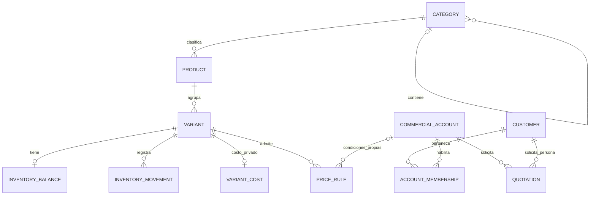
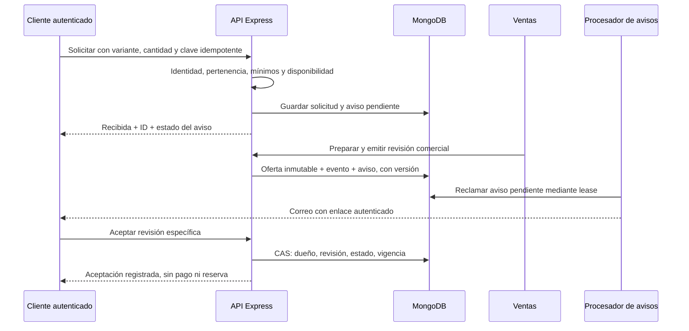

# VGV WEB: plan técnico de evolución comercial B2B

**Fecha:** 23 de octubre de 2026.

**Estado:** propuesta para revisión; no autoriza ni ejecuta implementación.

**Base:** [auditoría anterior](./AUDITORIA_VGV_WEB.md), contrastada con el código de trabajo sobre el commit `074b9df`.

## 1. Resumen ejecutivo

Se recomienda evolucionar la aplicación existente como **monolito modular**, conservando SvelteKit, Express, MongoDB/Mongoose, GridFS y Nodemailer. No hay necesidad demostrada de una reescritura, microservicios, proveedor de pagos ni ERP completo.

### Alcance confirmado por VGV

- El modelo principal será catálogo y solicitudes de cotización, **sin pago online ni pedidos pagados**.
- Los precios podrán variar por cliente y cantidad; las reglas de precedencia todavía no están definidas.
- El inventario será por variante/SKU, no por producto agregado.
- Existirán varios usuarios internos con permisos diferenciados.
- Las cuentas externas deben estar disponibles en la **primera versión comercial nueva**.
- Se conservarán identificadores, URLs, imágenes, relaciones y datos administrados cuando se evolucione el modelo.

### Diseño recomendado para aprobar

1. Proteger primero los datos: seed explícito y no destructivo, lecturas sin inserciones implícitas, errores de catálogo visibles y copia recuperable.
2. Mantener `Product.id` como identificador público. Introducir variantes con ID inmutable y SKU controlado; separar sus existencias y movimientos del contenido del producto.
3. Centralizar la taxonomía conservando sus **tres niveles actuales**: familia, subfamilia y categoría. No colapsarlos en dos ni agrupar únicamente por slug.
4. Separar costo interno, precio comercial y precio finalmente ofrecido. No resolver reglas comerciales ambiguas eligiendo silenciosamente la más barata, más reciente o más específica.
5. Conservar el modelo de autenticación de clientes y mejorar su aislamiento antes de reactivarlo. Introducir usuarios internos persistentes y permisos verificables por operación, objeto y campo.
6. Modelar la solicitud recibida y las versiones de la oferta comercial en la cotización existente. Una aceptación no constituye pago, pedido ni movimiento de inventario.
7. Guardar el trabajo de notificación junto al hecho comercial y reintentarlo de manera observable; el correo no será la fuente de verdad.
8. Migrar por expansión, adaptación y corte controlado, no por reemplazo de colecciones ni sincronización indiscriminada.

**No se modificó la aplicación, la auditoría ni la configuración.** No se ejecutaron pruebas de aplicación, builds, migraciones ni conexiones a bases/servicios en esta etapa. El inventario de datos reales y las verificaciones de staging están pendientes; no se presupone que los SKU actuales sean únicos ni que el stock global pueda repartirse automáticamente.

## 2. Estado actual contrastado con el código

Las afirmaciones de esta sección son verificaciones estáticas de implementación, **no pruebas funcionales de producción**. Los resultados de pruebas consignados en la auditoría son históricos y no se presentan como una nueva ejecución.

### 2.1 Hallazgos vigentes y precisiones

| Tema | Evidencia actual | Conclusión para el diseño |
|---|---|---|
| Persistencia de productos | [products.store.js](../Backend/data/products.store.js), `productSchema`, `normalizeEstado` | `id` String único; `codigo` con índice no único; costo, stock y estado están en producto. Variantes embebidas solo declaran SKU, medida y mínimo. No hay stock propio ni unicidad de SKU declarada. |
| Identidad de variantes | Mismo módulo: `normalizeVariantes` y `toProductDTO` | La salida normalizada no conserva un ID de variante; puede completar SKU con un valor generado y excluir variantes sin medida. Los datos crudos de Mongo pueden diferir de lo que muestra la API. No migrar desde el DTO normalizado. |
| Seed y lecturas | Mismo módulo: `seedIfEmpty`, `ensureReady`, `syncSeedProducts`; [server.js](../Backend/server.js) | Sigue vigente el riesgo: leer puede insertar seed en base vacía; sincronizar actualiza datos coincidentes salvo imagen/relaciones y puede borrar faltantes si se habilita esa opción. No se conoce el valor efectivo de los flags desplegados. |
| Publicación y stock mezclados | [products.controller.js](../Backend/controllers/products.controller.js), `buildUpdatePayload` | Marcar “disponible” sin stock puede asignar `1`; marcar “sin stock” fuerza cero. Esto no es un movimiento físico y no debe heredarse al inventario por SKU. |
| Taxonomía | [categorias.js](../catalogo-vgv/src/lib/data/categorias.js); esquema de producto | Tres niveles textuales y árbol estático frontend. Hay slugs repetidos bajo padres distintos, por ejemplo `sanitario` dentro de PVC y Fitting. Hace falta identidad por nodo y contexto de padre. |
| Catálogo | [página de catálogo](../catalogo-vgv/src/routes/catalogo/+page.svelte) | Carga todo, filtra en cliente y oculta productos cuyo stock no es positivo. No hay búsqueda/paginación de servidor en el controlador público revisado. Esa política puede ser inadecuada para cotizar abastecimiento futuro; requiere decisión, no cambio silencioso. |
| Fallback del frontend | [API products](../catalogo-vgv/src/routes/api/products/+server.js), [detalle](../catalogo-vgv/src/routes/api/products/[id]/+server.js) y equivalentes [productos](../catalogo-vgv/src/routes/api/productos/+server.js), [detalle productos](../catalogo-vgv/src/routes/api/productos/[id]/+server.js) | Sigue devolviendo muestra con éxito ante determinados fallos. Listado sustituye también respuestas no exitosas; detalle convierte respuestas no exitosas en 404 y usa muestra ante excepciones. |
| Dependencia del despliegue | [vercel.json](../vercel.json), [vite.config.js](../catalogo-vgv/vite.config.js), [backend-url.js](../catalogo-vgv/src/lib/utils/backend-url.js) | Hay rutas SvelteKit y Express superpuestas. Las rewrites declaradas envían `/api/*` a Express en Vercel; el fallback SvelteKit no debe suponerse activo en todos los accesos. Verificar rutas de navegador y SSR en staging antes de afirmar impacto efectivo. Docker usa frontend estático; no se ejecutan allí endpoints SvelteKit de servidor. |
| Login interno | [auth.controller.js](../Backend/controllers/auth.controller.js), [auth.js](../Backend/middlewares/auth.js), [login UI](../catalogo-vgv/src/routes/admin/login/+page.svelte) | Credenciales de variables/archivo externo, bcrypt y JWT; middleware solo admite `admin`. UI persiste JWT en `localStorage`; no hay administración persistente de roles/usuarios ni consulta de revocación en ese middleware. |
| Rutas administrativas | [products.routes.js](../Backend/routes/products.routes.js), [cotizar.routes.js](../Backend/routes/cotizar.routes.js) | CRUD, importación, imágenes y consulta/estado de cotizaciones requieren admin. Dar a Ventas acceso a estas rutas sin separar campos expondría costo y capacidad de cambiar stock. |
| Clientes: desactivación completa | [server.js](../Backend/server.js), [cuenta/+page.js](../catalogo-vgv/src/routes/cuenta/+page.js) | Backend responde 404 y la página redirige 307 al inicio. **Precisión respecto de la auditoría:** el formulario está conservado en código, pero no es una pantalla pública operativa que simplemente falle al invocar la API. Hay que retirar ambos bloqueos de manera coordinada, no solo montar rutas. |
| Autenticación externa conservada | [customer.controller.js](../Backend/controllers/customer.controller.js), [customers.store.js](../Backend/data/customers.store.js), [customer.routes.js](../Backend/routes/customer.routes.js) | Hay cookies HttpOnly/Secure en producción/SameSite=Lax, verificación de email, Google opcional, recuperación y `sessionVersion`. No se verificó SMTP/OAuth ni existencia de clientes reales. El registro/restablecimiento admite 128 caracteres mientras bcrypt limita por bytes; revisar esa política antes de activarlo. |
| Alcance del historial externo | [cotizar.controller.js](../Backend/controllers/cotizar.controller.js), `getCustomerQuotations` | La consulta incluye cotizaciones con `customerId` propio **o** sin dueño cuyo correo coincida. No basta para autorizar una cartera B2B compartida. Desactivar asociación automática por correo antes de exponer historial nuevo. |
| Solicitud actual | Mismo controlador: `sendQuotation` | Valida estructura con Joi; acepta nombres/IDs/SKU del navegador, no resuelve variantes contra catálogo. Asocia cliente solo si sesión completa y correo coincidente; guarda antes de SMTP; un 202 conserva la solicitud, pero no registra un trabajo durable de reintento. |
| Oferta comercial | Esquema y controladores de cotización | Solo líneas solicitadas y estado, sin importes ofrecidos, revisiones ni condiciones comerciales emitidas. Marcar `cotizacion_enviada` no prueba que se haya creado/enviado un documento comercial. |
| Semántica de estados | [dashboard](../catalogo-vgv/src/routes/admin/dashboard/+page.svelte), `changeQuotationStatus` | El texto de confirmación mezcla aceptación con “ya se recibió el pago” y finalización con entrega del pedido. No hay prueba de pagos/pedidos por ese texto; debe eliminarse esa semántica al rediseñar estados. No reinterpretar `confirmada` histórica como aceptación verificable de una oferta. |
| Imágenes y relaciones | [product-images.controller.js](../Backend/controllers/product-images.controller.js), [product-images.store.js](../Backend/data/product-images.store.js), [related-products.js](../Backend/utils/related-products.js) | Conservar GridFS, URLs, procesamiento Sharp y asociación con comparación de imagen esperada. Relaciones usan `Product.id`; no hace falta cambiarlas a IDs nuevos. |
| Eventos y refresco | [server.js](../Backend/server.js), [socket.js](../Backend/realtime/socket.js), dashboard | Socket exige admin al conectar y emite a todos los sockets autenticados del servidor. Dashboard además consulta cada 30 s, no solamente en Vercel. Cambiar roles exige autorización de eventos/suscripciones y expiración/revocación, no solo middleware HTTP. |

### 2.2 Qué debe comprobarse nuevamente fuera del código

- Datos crudos: SKU duplicados/vacíos/generados, subdocumentos `_id` existentes, cantidades decimales, productos sin variantes, relaciones rotas, costo desconocido y stock no asignable.
- Variables efectivas, proveedor de despliegue y topología de Mongo: replica set/transacciones, copias, retención, restauración y ventanas de mantenimiento.
- Orígenes públicos, cookies, CSRF y entrega de correo reales en staging; compatibilidad de rutas en ambos adaptadores si ambos continúan soportados.
- Conteo de clientes/cotizaciones históricas, propiedad demostrable de cada registro y significado real de sus estados.
- Volumen esperado, concurrencia de usuarios internos y reglas de visibilidad comercial. No se midió rendimiento de una base real.

La falta de pagos dejó de ser un bloqueante: **queda fuera de alcance por decisión comercial**. Reactivar cuentas y agregar stock por SKU dejaron de ser mejoras condicionales: son requisitos de la primera nueva versión.

## 3. Modelo de datos propuesto

**Todos los modelos/campos de esta sección son propuestos**, salvo los identificados como conservados. Los nombres de carpetas nuevas no describen archivos existentes. Evitar crear desde el inicio infraestructura genérica para un ERP.

### 3.1 Entidades y fuentes de verdad

| Entidad | Campos esenciales propuestos | Responsabilidad / identidad |
|---|---|---|
| `Product` (colección actual) | `_id` e `id` actuales; `codigo`, nombre, descripción; `categoryId`; `publicationStatus`; `imagen` actual; `relatedProductIds`; `schemaVersion`, `revision` | Contenido y agrupación comercial. Conservar `id` String exacto, incluso numéricos o ObjectId serializados. `codigo` no será la identidad de stock. Sin stock editable como verdad en producto. |
| `Category` | `_id`, `parentId`, nombre, slug, nivel, estado, orden | Un árbol común: familia → subfamilia → categoría opcional. Unicidad `(parentId, slug)` con normalización explícita; impedir ciclos, padres inexistentes y cambios de nivel inconsistentes. Producto referencia nodo más específico; API devuelve sus ancestros. |
| `Variant` | `_id` estable, `productId` = `Product.id`, `sku`, `skuKey`, `legacyAliases`, medida/atributos, unidad, mínimo, incremento de solicitud, `lifecycleStatus`, `revision` | Unidad inventariable y cotizable. Un producto simple tendrá una variante predeterminada aunque UI no obligue a escogerla. SKU es código de negocio; referencias usan ID de variante, no SKU mutable. |
| `InventoryBalance` | `variantId` único, cantidad física, estado de verificación, unidad, `version`, fecha de conteo | Una existencia por variante inicialmente. `cantidad=null`/estado `pendiente_conteo` significa desconocido, **no cero**. No hay reserva por cotización. Ubicaciones/bodegas separadas solo si VGV las necesita ahora. |
| `InventoryMovement` | `_id`, variante, delta, saldo anterior/posterior, tipo, motivo, actor, fecha, comando idempotente, origen | Libro de movimientos no editable. Saldo materializado y movimiento se confirman juntos; rectificar con movimiento compensatorio, no borrando historia. |
| `VariantCost` | `variantId`, monto decimal, moneda, base/unidad, fecha efectiva, estado de confirmación, actor/version | Costo interno, separado del catálogo y de las reglas comerciales. Conservar `precioCosto` legacy como evidencia hasta decidir su significado por variante. No copiarlo a todas las variantes suponiendo que es correcto. |
| `PriceRule` | Variante, tipo/ámbito, cuenta cliente opcional, tramos, moneda, base tributaria, vigencia, estado, versión | Condiciones de precio; sección 4. Ningún campo de costo. |
| `Customer` (actual) | `_id`, credenciales/Google, email verificado, `sessionVersion`, perfil existente; estado de cuenta | Identidad de una persona externa. Conservar IDs, hashes y vínculos existentes; no confundir rol externo con usuario interno. |
| `CommercialAccount` + `AccountMembership` | Cuenta con razón social/datos comerciales, estado y condiciones; membresía con persona, cuenta y alcance aprobado | Separar quién inicia sesión de para quién se cotiza. Una cuenta provisional individual por cliente actual; agrupación corporativa y acceso compartido solo con validación de VGV. No agrupar automáticamente por RUT, dominio o correo. |
| `InternalUser` | `_id`, username/email normalizados únicos según canal, hash, activo, roles, `sessionVersion` | Usuarios VGV persistentes. Sin autorregistro interno ni concesión de roles desde cuerpo/JWT del cliente. |
| `Quotation` (actual, ampliada) | `_id` actual, versión de esquema, solicitante/cuenta, snapshot de solicitud, estado de solicitud, ofertas versionadas, historial y avisos pendientes | Agregado comercial: solicitud y revisiones de oferta relacionadas; no entidad de venta. Sección 6. |
| `AuditEvent` (solo donde no exista historia de dominio) | Actor, operación, entidad/ID, cambios permitidos, motivo, fecha y correlación | Cambios de permisos, membresías, reglas y costos. No duplicar todo movimiento/historia comercial; no registrar secretos ni PII innecesaria. |

No introducir todas las colecciones en una entrega. Crear cada modelo junto con el caso de uso que lo necesita. `VariantCost` puede empezar como un documento por variante con cambios auditados; no hace falta contabilidad de valorización de inventario.

### 3.2 Producto, variante y stock

- **Producto:** página `/producto/:id`, contenido, clasificación y relacionados. Cambiar SKU no cambia esa URL. Para altas nuevas, sugerir ID técnico generado sin escanear máximo + 1, manteniendo el contrato String actual; no renumerar productos existentes.
- **Variante:** ID inmutable y atributos necesarios para seleccionar el artículo. SKU debe ser no vacío y único entre variantes nuevas/validadas de VGV, sujeto a aprobación de normalización.
- Recomendación de `skuKey`: normalizar espacios de extremos y comparación de mayúsculas/minúsculas, **sin eliminar puntuación, ceros o acentos automáticamente**. Registrar colisiones antes de crear índice único. Guardar SKU original y alias histórico.
- Los SKU ambiguos no se resuelven con “primer resultado”; tampoco se cambia automáticamente el SKU existente a otro inventado. Una clave técnica temporal puede permitir migrar, pero el artículo queda pendiente de validación y no cotizable como SKU confirmado.
- Para coexistir con pendientes, proponer índice único parcial sobre `skuKey` únicamente en variantes con SKU validado; los pendientes conservan el valor legacy aparte, sin clave validada. No liberar el SKU de una variante validada al archivarla: evita reutilizarlo confundiendo históricos. El servicio valida alias y no permite que un pendiente se active sin resolver su clave.
- Conservar IDs de subdocumentos embebidos si existen y son inequívocos, o asignar nuevos IDs con mapeo persistente. La API actual no demuestra que esos IDs estén presentes en los datos reales.
- Separar `publicationStatus` del producto (`borrador`, `publicado`, `archivado`) y `lifecycleStatus` de la variante (`activa`, `inactiva`). La disponibilidad se deriva de estado, saldo verificado y política de cotización aprobada.
- Publicar, ocultar o activar no altera el stock. No generar una unidad al marcar disponible.
- Para consultar sin stock: alternativa “solo existencias” frente a “admitir abastecimiento bajo consulta”. Recomendación provisional: admitir solicitud con advertencia para variantes activas si VGV aprueba esa política; **no prometer entrega** ni ocultar el dato desconocido.
- Si el público no debe ver cantidades exactas, serializar únicamente `con_stock`, `sin_stock`, `consultar` o `no_disponible` según política. No devolver el libro de movimientos.
- Una solicitud/aceptación de cotización no descuenta ni reserva stock. Hasta un módulo de inventario más amplio, ajustes documentados son la fuente operativa; no simular una venta con un ajuste automático.

**Consistencia:** proponer transacción Mongo para actualizar saldo con filtro por `version`, insertar movimiento con clave idempotente y registrar actor. Verificar soporte de transacciones en replica set antes de implementar; la configuración real no fue comprobada. Si solo hay Mongo standalone, resolver esta precondición en staging o aprobar otro diseño atómico explícito; no aceptar “saldo actualizado y log fallido” como éxito.

En cambios sensibles con `AuditEvent` separado, confirmar modificación y auditoría en la misma transacción. En cotizaciones usar historial embebido y en inventario su propio movimiento; evitar prometer auditoría si solo se escribe a consola después del cambio. Clasificar costo en el registro de auditoría como dato privado, con el mismo permiso de lectura.

Decidir unidades/múltiplos antes de validar movimientos. Si hay venta por metros o fracciones, usar representación decimal exacta y escala aprobada; no imponer enteros solo porque el checkout actual los exige.

### 3.3 Imágenes, relaciones y compatibilidad

- Conservar `Product.imagen` exactamente y los archivos GridFS existentes. No re-subir ni mover imágenes como parte de la migración de SKU.
- Añadir imágenes por variante o galería **solo cuando exista necesidad aprobada**: referencias a URL actual o GridFS, texto alternativo y orden; heredar imagen de producto cuando la variante no tenga propia. El uploader actual solo asocia al producto, no asumir soporte para variante.
- El matching por nombre de archivo en [image-matching.js](../catalogo-vgv/src/lib/utils/image-matching.js) busca código/ID/SKU. Mantener compatibilidad, mostrar ambigüedad y pedir selección; un SKU duplicado no debe sobrescribir otra imagen.
- `relatedProductIds` conserva IDs de producto y orden; validar existencia y mantener el límite actual de 20 mientras se evoluciona.
- Archivar en lugar de borrar referencias utilizadas en ofertas o movimientos; conservar snapshots para que el histórico no dependa del catálogo actual.
- Mantener DTO legacy temporal para los consumidores públicos que solo necesitan nombre/imagen/relaciones; stock agregado será **proyección no editable**, nunca una segunda fuente de verdad. No usar la suma si hay variantes de unidades incompatibles o saldos desconocidos.
- Migrar `mapProduct`, formulario, carrito e importador junto con la API. El normalizador actual descarta campos desconocidos y el update reescribe el producto normalizado; no añadir campos v2 y seguir pasando escrituras por ese camino.

Los nodos son conceptos propuestos, no colecciones ya presentes. Durante migración pueden existir productos todavía sin variante validada y cotizaciones legacy sin cuenta.

## 4. Diseño de precios B2B

### 4.1 Separación obligatoria

1. **Costo:** solo usuarios con permiso `cost.read`/`cost.write`. No entra en DTO públicos, respuestas a clientes, relacionados, eventos generales, documentos comerciales ni correos externos.
2. **Precio comercial de referencia:** valor orientativo por variante con moneda y base tributaria explícitas. Puede mantenerse oculto si el artículo se cotiza manualmente.
3. **Precio aplicable propuesto:** resultado de reglas aprobadas para una cuenta, cantidad y fecha. No es un compromiso hasta que Ventas emita una oferta.
4. **Precio ofrecido:** snapshot inmutable de una revisión emitida, junto con cantidades y condiciones. Cambiar listas no altera esa revisión.

El `precioCosto` actual **no es** el precio general ni una base autorizada para calcular margen. Un fixture de prueba que contiene un campo `precio` no demuestra que exista una función comercial.

### 4.2 Modelo mínimo de regla

`PriceRule`: ID/version; `variantId`; `scope` (`general` o `cliente`); `commercialAccountId` obligatorio solo para cliente; estado borrador/publicado/inactivo; vigencia desde/hasta; moneda; unidad/base; tipo `precio_fijo`, `tramos` o `cotizacion_manual`; visibilidad.

- Un precio fijo lleva monto exacto. Tramos llevan límites y monto unitario; validar límites ordenados, sin superposición dentro de una regla y cobertura/gaps explícitos.
- Guardar montos como decimal exacto (por ejemplo Decimal128 en Mongo y cadenas decimales en JSON), no usar `Number` flotante para cálculos financieros. Elegir moneda, escala y redondeo con VGV antes del calculador.
- No incorporar descuentos porcentuales acumulables ni fórmulas sobre costo en el primer modelo: no están aprobados.
- `CommercialAccount` puede referenciar condiciones comerciales versionadas: plazo de pago acordado, validez, entrega orientativa y notas para oferta. Son condiciones informativas/contractuales revisadas por Ventas, no crédito aprobado automáticamente ni contabilidad.
- Los índices de consulta considerarían variante, ámbito/cuenta, estado y vigencia. Un índice no resuelve por sí mismo superposiciones temporales; validarlas en servicio y controlar publicaciones concurrentes.

### 4.3 Decisiones sin precedencia inventada

| Decisión | Alternativas y consecuencias | Recomendación provisional, no regla aprobada |
|---|---|---|
| Precio cliente frente a tramo general | Precio cliente siempre reemplaza: simple y predecible; elegir menor: favorece descuento pero puede incumplir convenio; combinar: mayor complejidad y margen incierto. | Pedir prioridad explícita. Hasta aprobar, mostrar conflicto a Ventas y resolver manualmente; no publicar un monto calculado ambiguo al cliente. |
| Tramos de cliente y generales | Un plan por cuenta/SKU con sus tramos: más datos pero determinista; reglas superpuestas: flexible, requiere prioridad y auditoría. | Preferir un plan explícito por ámbito y versión; aún se debe acordar cómo se elige ámbito. |
| Cálculo de tramos | Precio unitario de toda la línea según cantidad total frente a precio progresivo por bloques. | VGV debe elegir. No inferirlo del nombre “tramo”. El tipo de cálculo se versionará antes de activarse. |
| Cantidad usada | Por línea/SKU; agrupar líneas iguales; agrupar familia/producto o cantidades de varias solicitudes. | Sugerir cantidad consolidada por SKU dentro de una solicitud, pero requiere aprobación. No acumular solicitudes ni mezclar variantes por defecto. |
| Artículo “a cotizar” | Sin monto visible; rango orientativo; referencia no vinculante. ¿Anula cualquier regla cliente? | Mantener `cotizacion_manual` y no calcular hasta que VGV defina si puede coexistir y con qué prioridad. |
| Impuestos y moneda | Neto o bruto; una o varias monedas; precios con o sin vigencia. | Una moneda inicial si VGV confirma; etiquetas explícitas y redondeo aprobado. No asumir CLP ni tasa de IVA en la implementación. |
| Visibilidad | Público, solo sesión, cuenta comercial aprobada o únicamente oferta de Ventas. | Lanzar cotización manual sin exponer condiciones privadas; habilitar referencias visibles cuando se apruebe la política. |
| Excepciones de Ventas | Libre edición; autorización superior; umbral de descuento/margen. | Permiso independiente `quote.price.override`, motivo obligatorio y revisión si VGV lo requiere. No inventar umbrales ni márgenes. |

### 4.4 Servicio de resolución

Entrada del backend: variante, cantidad/unidad, fecha de referencia y cuenta **derivada de la sesión/membresía**, no del `customerId` que mande el navegador.

Salida tipada: `resuelto` con regla/version/monto/base; `requiere_cotizacion`; `sin_regla`; o `conflicto`. Los tres últimos no equivalen a cero. Fallas técnicas se devuelven como error 5xx, no como precio ausente válido.

Si la precedencia o el cálculo no está aprobado, se puede lanzar la nueva plataforma con **oferta manual de Ventas**, registrando motivo/origen del importe. Eso mantiene el flujo B2B sin fabricar reglas. Una vez aprobado el motor, el backend recalcula al emitir y Ventas confirma el resultado; cualquier cambio tras una vista preliminar requiere revisión, no aceptación silenciosa.

Precios por cliente y condiciones privadas: `Cache-Control: private, no-store`, sin caché compartida de CDN/SSR, sin listas de otros clientes en respuestas y sin parámetros públicos que permitan consultar otra cuenta. El cliente ve solo el importe/condición que se le puede ofrecer, no todas las reglas candidatas.

## 5. Usuarios, roles y permisos

### 5.1 Separar identidad de autoridad

- **Internos:** `InternalUser`, activación por administrador y permisos de negocio. Migrar el acceso actual sin conservar credenciales compartidas como forma normal de operación.
- **Externos:** conservar `Customer`, email verificado y cuenta comercial/membresía. Verificar email no valida razón social, poderes de representación ni acceso a otras personas.
- No unificar usuarios internos y clientes en esta etapa. Separar cookies, audiencia/emisor y claves JWT; un token externo no sirve en APIs internas, aunque se manipule un `role`.
- Recomendación incremental: mantener JWT existente pero llevar sesión interna a cookie HttpOnly/Secure/SameSite en despliegue same-origin y comprobar usuario activo/`sessionVersion` en backend. No hace falta incorporar refresh tokens complejos ahora. Las sesiones externas ya tienen una base reutilizable.
- Consultar permisos vigentes/versión en cada petición relevante y transición; revocar al cambiar roles, desactivar o cerrar sesión. Fallo DB al validar identidad debe devolver 503, no degradar a invitado ni tratarlo como autorización.
- Login, logout, recuperación y cambios protegidos por límites, CSRF y validación de origen. SameSite y CORS no reemplazan CSRF: usar token anti-CSRF en operaciones con cookie y validar Origin/Referer contra allowlist. Mantener desarrollo localhost explícitamente separado.
- Cookies no protegen contra acciones de una XSS; reducir CSP permisiva de manera compatible con los adaptadores y validar renderizado. No se afirma que haya una XSS comprobada.
- Google es opcional: no condiciona cuentas desde v1 si email/contraseña y recuperación ya funcionan. Validar CSP y origen para Google solo si se habilita.

### 5.2 Matriz inicial para evaluación, no roles definitivos

**A** = autorizado; **P** = únicamente objetos propios; **N** = denegado; **D** = decisión explícita pendiente, denegado hasta aprobación.

| Capacidad | Administrador | Ventas | Inventario | Cliente |
|---|---:|---:|---:|---:|
| Ver catálogo publicado | A | A | A | A |
| Crear/editar ficha, categorías e imágenes | A | D | D | N |
| Ver existencias internas por SKU | A | A | A | N; solo disponibilidad pública aprobada |
| Registrar ajuste/movimiento | A | N | A | N |
| Ver/escribir costos | A | D / N | D / D | N |
| Gestionar listas/reglas de precio | A | D | N | N |
| Ver precio ofrecido a su cuenta | A | A según cartera | N | P |
| Ver datos personales y solicitudes | A por tarea autorizada | A según cartera aprobada | N | P |
| Preparar/emitir/revisar oferta | A | A | N | N |
| Cambiar precio fuera de regla | A con motivo | D | N | N |
| Aceptar/rechazar oferta | Registro delegado con evidencia | Registro delegado con evidencia | N | P, solo versión vigente |
| Gestionar usuarios, roles y membresías | A | N | N | N |
| Consultar auditoría | A | D, acotada | D, de inventario | Solo historial comercial propio saneado |
| Exportar | A según contenido | D, cartera y sin costos | D, inventario sin PII/costos | D, solo documento comercial propio |

Permisos sugeridos: `catalog.write`, `inventory.read`, `inventory.adjust`, `cost.read`, `cost.write`, `pricing.manage`, `quote.read`, `quote.issue`, `quote.price.override`, `customer.read`, `user.manage`, `audit.read`. Los nombres son propuesta técnica; la asignación y el alcance “toda cartera/asignada” los aprueba VGV. Un rol no implica leer automáticamente todos los campos del modelo.

### 5.3 Aislamiento de clientes y datos sensibles

1. Consultas externas filtran en Mongo por `_id` **y** sujeto/cuenta con membresía autorizada. No cargar todo y filtrar en Svelte. Un ID conocido no otorga acceso; devolver 404 para objeto ajeno sin revelar existencia.
2. Alcance provisional seguro: una persona ve únicamente solicitudes propias. Acceso de varias personas a una empresa requiere cuenta validada y permiso compartido explícito; no habilitarlo por declarar el mismo RUT.
3. En alta, tomar identidad de la sesión verificada; `customerId`, cuenta, roles y precio enviados por cliente se rechazan/ignoran según contrato explícito. Dirección/contacto son snapshot validado, no mecanismo de pertenencia.
4. Cotizaciones antiguas sin dueño no se asignan por igualdad de email. Usar proceso de reclamación validado por VGV, prueba de titularidad y auditoría; las ambiguas permanecen internas.
5. DTO por lista permitida: catálogo público, inventario, Ventas, cliente y costos separados. `withoutCost` elimina solo el costo raíz actual y no basta para futuros objetos anidados, galerías de datos, exportaciones o eventos.
6. Proteger listado, detalle, cambios, aceptación, exportación/documento, búsquedas, historial y notificaciones. La pertenencia se comprueba en cada operación y en tareas diferidas antes de enviar material sensible.
7. Realtime: no reutilizar `socketServer.emit` general para precios o cotizaciones privadas. Autorizar salas por permiso/sujeto en servidor, revalidar expiración/revocación y enviar eventos mínimos. Polling HTTP sigue siendo opción simple inicial.
8. Errores/logs no deben registrar contraseñas, JWT, tokens de verificación ni documentos personales completos. Historial externo no mostrará notas internas, márgenes ni identidades internas innecesarias.

### 5.4 Reactivación coordinada de cuentas

Modificar en una futura entrega backend montado, redirect de página, navegación, historial, checkout y correos de verificación. El prellenado está comentado, no constituye soporte listo.

Revisar longitudes en bytes de bcrypt sin cambiar el algoritmo a ciegas; tokens de verificación de un uso, recuperaciones concurrentes, expiración, revocación y fallos SMTP. Resolver si autorregistro requiere aprobación comercial aparte de email verificado.

Como `vercel.json` solo enruta actualmente `/admin/products*` a Express, proponer nuevas APIs internas bajo `/api/internal/*` (ya cubierto por `/api/*`) sin confundirlas con rutas UI `/admin/*`. Mantener adaptadores de las rutas actuales hasta el corte; **no cambiar rewrites ahora**.

## 6. Flujo comercial de cotizaciones

### 6.1 Solicitud, oferta y aceptación son hechos distintos

- **Solicitud recibida:** VGV guardó una petición; todavía no prometió precio, plazo ni existencia.
- **Oferta comercial emitida:** Ventas publicó una revisión con importes/condiciones y validez explícitos. Notificar por SMTP es un proceso separado.
- **Oferta aceptada:** persona autorizada acepta una revisión específica dentro de su vigencia, o Ventas registra aceptación con evidencia si se aprueba esa alternativa. No significa pagada, vendida, despachada ni reservada.

Conservar `Quotation._id`; ampliar el agregado con:

- `request`: `requestedByCustomerId`, `commercialAccountId`, perfil/dirección de contacto snapshot, líneas originales validadas (producto/variante/ID público/SKU/nombre/unidad/cantidad), fecha, canal y estado (`recibida`, `en_revision`, `cerrada`).
- `offers`: revisiones con número, estado borrador/emitida/sustituida/aceptada/rechazada/vencida; líneas ofertadas, referencias y versiones de reglas o precio manual justificado, moneda/base/impuestos/descuentos solo si aprobados, condiciones, vencimiento, emisor y fecha.
- `acceptance`: oferta y revisión exactas, actor externo/interno, momento, modalidad/evidencia y versión del documento. No permitir que el cliente “acepte” un borrador o condiciones modificadas.
- `history`: eventos comerciales con actor ID, fecha, motivo, versión previa/nueva y correlación; distinguir campos públicos de notas internas.
- `notificationTasks`: destinatario autorizado, evento/revisión, estado, intentos, `nextAttemptAt`, lease, último error saneado e ID de deduplicación.

Revisiones emitidas son inmutables. Si hay cambios se prepara otra revisión; sustituir una oferta vigente exige acción explícita y aviso, no reescribirla. Acotar número/tamaño de líneas, revisiones, historial y tareas para no superar el límite BSON de Mongo; archivar/dividir posteriormente si el volumen medido lo exige.

### 6.2 Secuencia propuesta

1. **Selección:** navegador guarda solo lista de intención. Clave del carrito v2 evolucionada a `variantId`; datos locales de precio/stock no son autoritativos.
2. **Autenticación:** para solicitud B2B identificada, usar cuenta verificada/perfil completo y membresía válida. Mantener o no el envío invitado es decisión pendiente; sugerir conservarlo como entrada no vinculada sin precios/historial privados, con UX explícita. No romper el flujo actual silenciosamente.
3. **Validación backend:** obtener productos/variantes en lote; comprobar existencia, pertenencia al producto, estado y política de disponibilidad. Validar cantidad, unidad, mínimo e incremento según reglas aprobadas. Consolidar duplicados antes del cálculo si esa política se aprueba; no redondear ni sustituir artículos sin confirmar.
4. **Identidad:** sesión determina solicitante y cuenta; Ventas creando en nombre de otro requiere permiso, cliente seleccionado y actor delegado auditado.
5. **Recepción durable:** guardar solicitud con ID/fecha y snapshot validado. Idempotencia por actor/cuenta/canal y clave de comando; misma clave+contenido devuelve el resultado inicial, contenido diferente devuelve 409. Esto evita duplicados por timeout sin asumir que SMTP o el navegador son confiables.
6. **Respuesta:** devolver confirmación de persistencia, identificador y estado de notificación. Vaciar carrito solo tras recepción confirmada; con timeout ambiguo reintentar la misma clave o consultar resultado autorizado. DB caída no genera éxito.
7. **Trabajo de Ventas:** asignación/responsable si VGV lo pide, revisión de stock y condiciones, precio manual o resolución de reglas aprobadas. Sustituciones y diferencias entre solicitado/ofertado se muestran, no reemplazan la solicitud original.
8. **Emisión:** Ventas confirma cantidades/precios/condiciones/validez, publica una revisión inmutable y crea tarea de aviso en la misma escritura del agregado con control de versión. Campos incompletos/conflictos bloquean emisión con error explícito.
9. **Notificación:** SMTP envía aviso a Ventas de recepción y al cliente de oferta/aceptación según política aprobada, preferentemente enlace autenticado a documento saneado. No enviar costo ni adjuntar datos de otro cliente.
10. **Respuesta del cliente:** aceptar/rechazar revisión vigente con filtro por dueño/membresía, estado esperado y vencimiento evaluado en servidor. Revisiones obsoletas, ya sustituidas o una carrera concurrente devuelven 409. Volver a comprobar pertenencia y consentimiento ante cambios.
11. **Cierre:** registrar desistimiento/rechazo/vencimiento/cierre administrativo con motivo. No añadir “pagada”, “pedido entregado” ni descuento de stock a este flujo.

### 6.3 Avisos, fallos y auditoría

Propuesta inicial: **outbox embebida** en el agregado de cotización. Significa guardar “hay un aviso pendiente” junto al cambio comercial, no instalar una cola externa. Reclamar cada tarea de forma atómica con lease/expiración permite recuperar un procesador caído; usar clave `(evento, revisión, destinatario)` para evitar crear tareas duplicadas y reintentos con espera acotada.

- SMTP caído: el hecho comercial permanece confirmado; UI informa “registrada; aviso pendiente”, panel muestra cola y motivo saneado, operador puede reintentar con permiso y queda auditado.
- SMTP aceptó el correo y el proceso cayó antes de marcar enviado: puede enviarse duplicado. No prometer entrega exactamente una vez; usar Message-ID estable y contenido idempotente cuando sea útil. “Enviado” significa aceptado por SMTP, no leído/entregado al buzón.
- Soporte operativo: máximo de intentos/retención y alertas requieren umbrales acordados. Errores permanentes quedan visibles para intervención, no se descartan.
- Procesador persistente dentro del mismo servicio en host duradero, o tarea programada autenticada con lote acotado en plataforma serverless. No arrancar un bucle eterno dentro de una función Vercel. Elegir mecanismo tras confirmar plataforma; no crear microservicio por esta necesidad.
- Verificación/recuperación de cuentas también necesita notificación recuperable; no guardar tokens sin protección en outbox/logs. Si un reintento requiere el token, cifrar el payload de corta vida con clave privada administrada, borrarlo al enviar/expirar y conservar en cuenta solo hash; alternativamente reemitir un enlace nuevo y anular el anterior con política explícita. No intentar recuperar el token desde su hash.
- Actualización de estado y evento comercial se escriben juntos con `revision` esperada; un error de persistencia no produce evento Socket.IO ni correo de éxito.

### 6.4 Transición desde estados actuales

| Estado legacy | Qué se puede afirmar | Tratamiento propuesto |
|---|---|---|
| `pendiente` | Registro de solicitud pendiente | Importar como solicitud recibida legacy conservando estado/historial originales. |
| `cotizacion_enviada` | Un operador marcó el estado | Conservar marca histórica, **sin fabricar** oferta ni fecha/contenido/envío. Ventas puede adjuntar evidencia y emitir nueva revisión. |
| `confirmada` | Marca manual con texto UI que mezcla aceptación/pago | No migrar como aceptación válida ni pago probado. `legacyStatus` y revisión manual si se necesita continuidad comercial. |
| `completada`, `desistida` | Cierre histórico declarado | Conservar cierre original; no crear movimiento, despacho o pedido. Aprobación humana antes de clasificar en estados nuevos. |

## 7. Arquitectura modular progresiva

### 7.1 Límites propuestos dentro de Express

| Módulo | Dueño de datos / servicios | Lo que no debe hacer |
|---|---|---|
| Catálogo | Product, Variant, Category, referencias de imagen, lectura pública y relacionados | Cambiar saldos o devolver costos como parte de la ficha pública. |
| Inventario | Balance y movimientos; lectura de disponibilidad; ajustes auditados | Interpretar una aceptación de cotización como salida de almacén. |
| Clientes | Customer/perfil, cuenta comercial y membresías | Asignarse rol interno o declarar propiedad de una empresa sin validación. |
| Identidad y autorización | InternalUser, sesiones, permisos y políticas por objeto | Permitir acceso por navegación/UI o confiar en permisos enviados por cliente. |
| Precios | Reglas/versiones, resolución y condiciones; acceso privado a costo mediante permiso separado | Usar costo como precio automáticamente o tomar prioridad no aprobada. |
| Cotizaciones | Solicitud, revisiones, aceptación, historia y coordinación de validación | Reescribir catálogo/costo o generar cobros/pedidos. |
| Notificaciones | Composición segura, entrega, reintento y observabilidad de tareas | Decidir estados comerciales basándose en si SMTP funcionó. |

Propuesta de organización futura: `Backend/modules/<modulo>/{model,repository,service,routes}` **solo cuando el tamaño lo justifique**, sin crear cuatro archivos vacíos por entidad. Primero extraer servicios concretos desde controladores/store existentes y mantener las rutas como adaptadores. Conservar utilidades de imagen y formularios ya probados.

Controladores traducen HTTP; servicios aplican permisos y reglas; repositorios hacen consultas específicas. Cotizaciones consulta servicios de catálogo, inventario y precios; no importa modelos privados para modificarlos. Compartir únicamente conexión Mongo, contexto de actor, errores tipados y utilidades realmente comunes.

Errores esperados: 400/422 para validación según contrato unificado, 401 para sesión ausente/inválida, 403 para permiso insuficiente, 404 para objeto ausente/ajeno, 409 para conflicto/revisión/idempotencia y 503 para infraestructura temporal. Elegir 400 o 422 consistentemente, sin convertir todas las excepciones a 400.

### 7.2 Contratos de API propuestos, no endpoints actuales

| Superficie | Propuesta de contrato |
|---|---|
| Pública | Conservar `/api/products`, `/api/productos` y `/producto/:id`; añadir datos v2 compatibles. Listados paginados nuevos con contrato explícito sin cambiar silenciosamente array por objeto. Categorías mediante endpoint de lectura. |
| Cliente | Conservar `/api/clientes/*` para autenticación/perfil; listado/detalle de sus cotizaciones y acción de aceptar/rechazar oferta concreta bajo el mismo espacio, con filtro de propiedad. |
| Interna | `/api/internal/catalog/*`, `/inventory/*`, `/pricing/*`, `/quotations/*`, `/users/*` con autorización por capacidad. Rutas actuales de admin se adaptan temporalmente al mismo servicio, sin bypass de permisos/stock. |
| Solicitud | Conservar `/api/cotizar` durante transición; modo v2 requiere variante estable y claves de comando. Aceptar payload legacy solo si se puede mapear de forma inequívoca y no pierde validación. |

Los nuevos campos no aparecen mágicamente en el frontend: [fetchproductos.js](../catalogo-vgv/src/lib/utils/fetchproductos.js) los proyecta explícitamente; [save-product.js](../catalogo-vgv/src/lib/utils/save-product.js) debe adoptar la sesión y contratos nuevos sin perder su recuperación ante fallo de imagen. Evitar endpoints SvelteKit duplicados con distintas políticas; mantener un único dueño de reglas en Express.

### 7.3 Decidir ahora / posponer

**Ahora:** identidades inmutables; stock por SKU con movimiento; DTO allowlist; cuenta externa separada de usuario interno; permisos por objeto; revisiones comerciales; idempotencia; migraciones versionadas; fechas UTC y moneda/unidad explícitas.

**Posponer:** contabilidad, remuneraciones, logística completa, CRM integral, pedidos/pagos, compras a proveedores, valorización contable, multiempresa SaaS, motor genérico de workflows y microservicios.

Una cuenta comercial cliente no es un tenant: varias empresas compradoras de VGV siguen dentro de un negocio vendedor. Antes de ofrecer el sistema a varias empresas vendedoras habrá que decidir aislamiento de tenant, claves únicas por empresa, permisos/membresías internas, correo/configuración por negocio, imágenes y reglas de precio aisladas, exportación/borrado y respaldos. No añadir un `tenantId` decorativo sin filtros obligatorios ni diseñar todos los módulos ERP ahora.

## 8. Plan de migración segura (no ejecutado)

### 8.1 Preparación e inventario de datos

1. Identificar staging y producción por conexión/base verificadas por el responsable; no usar valores heredados por fallback. Bloquear ejecución de scripts de migración sin destino explícito, modo y confirmación del operador.
2. Inventariar **documentos crudos** con consultas de solo lectura en una copia autorizada, sin `listProducts()`/`ensureReady()` ni normalizadores que insertan/reparan datos. No se hicieron esas consultas en este trabajo.
3. Inventario: conteos, `_id`/`id`/códigos, variantes originales y subdocumentos IDs, SKU tal como están y normalizados, mínimos, unidades conocidas/desconocidas, stock, costo, taxonomía completa, imágenes/GridFS y relaciones.
4. Inventariar clientes, cotizaciones sin dueño, referencias, estados y timestamps sin inferir pertenencia por correo. Mantener PII fuera de logs/reportes de migración públicos.
5. Detectar SKU faltantes, repetidos dentro del producto y entre productos, colisiones por normalización y alias ambiguos. Identificar códigos generados solo por DTO y pérdida de variantes al normalizar.
6. Detectar combinaciones de categoría no incluidas en el árbol estático; construir categorías por cadena completa de padres. No fusionar nodos solo porque se llaman igual.
7. Copia consistente de colecciones e índices y de GridFS (`files` y `chunks`), más assets públicos y metadatos/mapeos de migración. Probar restauración completa en base aislada; proteger copias de PII, hashes y material privado.

### 8.2 Reglas de transformación propuestas

| Caso encontrado | Acción segura |
|---|---|
| Producto simple sin variantes | Crear variante predeterminada con ID técnico estable. Reutilizar código como SKU solo después de verificar unicidad y significado. Stock puede transferirse íntegro si unidad/significado son confirmados y se registra saldo inicial. |
| Una variante conocida | Tras confirmar unidad y alcance, asignar stock global una sola vez con movimiento de apertura y mapeo; no duplicarlo en producto y variante como dos saldos editables. |
| Varias variantes con stock global | No repartir por partes iguales ni copiar stock completo a cada una. Guardar valor original en snapshot y tabla de conciliación; stock nuevo pendiente hasta asignación/recuento aprobado. |
| SKU duplicado/faltante | Mapeo y revisión humana; mantener variante sin publicar/cotizar si es ambigua. No crear índice único antes de resolver registros aprobados y definir tratamiento de legacy pendiente. |
| Costo global con varias variantes | Conservar costo legacy con su origen; nuevos costos quedan sin confirmar hasta validar base/unidad por SKU. Cero actual no demuestra costo gratuito. |
| Imagen o relacionado ya válido | Preservación exacta de referencia/bytes; no reasignar por nombre de SKU durante migración. |
| Cotización histórica | Preservar `_id`, líneas y estados originales, marcar esquema legacy y aplicar política de propiedad validada. No inventar precios/revisiones/aceptaciones. |
| Cuenta histórica externa | Conservar Customer._id, hashes y sesión/Google; crear mapeo de cuenta individual si corresponde. Agrupar empresa solo con autorización y trazabilidad. |

### 8.3 Secuencia expandir → adaptar → cortar

1. **Congelar semánticas peligrosas:** en futura entrega, seed solo explícito, lecturas sin seed, no fallback exitoso de muestra en producción; no cambiar datos de negocio en esta preparación.
2. **Expandir:** campos/colecciones v2 y registro de migración por versión con mapeo estable. Lectores aceptan legacy y v2; escritores v2 no atraviesan `normalizeEstado` antiguo.
3. **Dry-run:** generar plan de cambios, bloqueos y mapeos sin escribir; revisar y aprobar con responsables. Un dry-run que invoca un store con seed no es aceptable.
4. **Ensayo en copia aislada:** aplicar por lotes idempotentes con checkpoints, sumas de control, manifiesto de registros creados/cambiados e índices controlados. Reejecutar y probar interrupción/reanudación sin duplicar variantes, saldo ni movimientos iniciales.
5. **Adaptar superficies:** formulario/table/grid/card, selector de variante, carrito, API, DTO, importación/exportación, matching de imágenes, productos relacionados, checkout, cuentas y dashboard.
6. **Preparar corte:** ventana breve de pausa de escrituras de stock/catálogo afectadas; recapturar respaldo/deltas y hashes antes de asignar saldos. No inventar dual-write sin protocolo.
7. **Corte por fuente:** inventario v2 pasa a fuente única; legacy stock queda solo proyección/no editable. Rutas legacy deben invocar el servicio nuevo o rechazar operaciones incompatibles; no seguir permitiendo sobrescrituras completas del store viejo.
8. **Validación:** equivalencia de IDs/URLs/imágenes/relaciones/costo legacy; conteos y stock por unidad con firma de conciliación; tests de propiedad/roles, ofertas y avisos.
9. **Observación:** logs saneados, errores, discrepancias de stock, avisos pendientes y registro de acceso. No borrar campos legacy/backups hasta cerrar ventana de recuperación aprobada.

### 8.4 Reversibilidad y recuperación

- Migración aditiva mantiene documentos legacy y snapshots de campos modificados. Deshacer solo los registros del manifiesto sin escrituras posteriores; identificar por versión/hash, nunca borrar “todos los nuevos”.
- **Antes de escrituras v2:** se puede volver al lector/escritor anterior compatible con las protecciones de E0, restaurando solo cambios controlados del lote. Conservar los mapeos y usar control de versión para no sobrescribir cambios de otro lote.
- **Después de nuevos movimientos/aceptaciones:** rollback binario al escritor legacy **no es seguro**. Pausar escrituras, conservar journal completo de nuevos hechos y aplicar corrección hacia adelante o restore + reproducción validada. No regresar a stock agregado perdiendo movimientos por SKU.
- Restore total es último recurso aprobado con RPO/RTO conocidos; exportar los hechos posteriores antes y conciliar/reproducirlos. RPO = cuánto dato se tolera perder; RTO = cuánto tiempo se tolera estar detenido. VGV debe fijarlos.
- Revocación/rotación de sesiones y cierre de flags al desactivar una entrega no deben habilitar rutas menos protegidas. Mantener lectura segura mientras se recupera servicio.

## 9. Etapas de implementación para aprobar

Ninguna etapa se implementó aquí. Las entregas son PR pequeños de un objetivo; no implican publicar versiones comerciales incompletas. **La nueva versión v1 solo se aprueba al completar cuentas, permisos, inventario por SKU y flujo de cotización seguro**, aunque el motor automático de precios pueda seguir manual por decisión explícita.

### E0 — Proteger datos y establecer recuperación (primera entrega)

- **Objetivo:** eliminar efectos peligrosos de lecturas/seed y falsa disponibilidad; establecer baseline/restore.
- **Áreas:** [products.store.js](../Backend/data/products.store.js), [products.controller.js](../Backend/controllers/products.controller.js), [server.js](../Backend/server.js), [smoke-dev.mjs](../scripts/smoke-dev.mjs), endpoints SvelteKit products/productos y guía de despliegue, a revisar en implementación.
- **Datos:** no reasignar stock, SKU ni IDs; separar seed administrativo explícito de lectura normal. La corrección debe contemplar `sin stock` que hoy fuerza cero y `disponible` que inventa una unidad; no cambiar disponibilidad histórica automáticamente.
- **Dependencias:** responsable del entorno, copia y política de seed aprobada; staging sin producción.
- **Pruebas:** base vacía permanece vacía al leer; sincronización no pisa campos administrados; error backend no produce muestra como real; activar/ocultar no modifica cantidades; restore.
- **Riesgo:** entornos demo ya no se poblarán automáticamente; mantener comando de inicialización solo para demo aislada.
- **Aprobación:** no hay escritura implícita por lectura, campos operativos preservados y backup restaurado.
- **Volver atrás:** no reactivar seed destructivo para resolver un fallo; mantener modo seguro/solo lectura y revertir UI o adaptadores incompatibles.

### E1 — Contratos e identidad aditiva del catálogo

- **Objetivo:** introducir categorías/variantes/mapeos estables y DTO por audiencia sin mover inventario todavía.
- **Áreas:** store/controlador de productos; nuevos modelos/servicios de catálogo; [ProductForm.svelte](../catalogo-vgv/src/lib/components/ProductForm.svelte), [fetchproductos.js](../catalogo-vgv/src/lib/utils/fetchproductos.js), páginas catálogo/producto, helpers de guardado/imagen y relacionados.
- **Datos:** Category/Variant, `schemaVersion`/revisión, mapeo legacy; preservar costos/stock sin interpretarlos.
- **Dependencias:** E0; política de SKU y taxonomía aprobada para migrar registros concretos.
- **Pruebas:** snapshot de identidades/URLs, conflictos SKU, jerarquías, relaciones e imágenes; DTO no filtra costo anidado.
- **Riesgo:** el normalizador viejo puede descartar datos v2; adaptar escrituras antes de habilitar campos nuevos.
- **Aprobación:** equivalencia del catálogo y mapeos auditables; registros ambiguos explícitamente pendientes.
- **Volver atrás:** desactivar lectura v2 conservando mapeos; no borrar variantes editadas tras la migración.

### E2 — Identidades, cuentas y permisos sin exposición prematura

- **Objetivo:** usuarios internos individuales, sesión revocable, matriz de permisos y cuentas externas con acceso propio.
- **Áreas:** auth/customer controllers, middleware, rutas, server y sockets; login/dashboard; [cuenta/+page.js](../catalogo-vgv/src/routes/cuenta/+page.js), [cuenta/+page.svelte](../catalogo-vgv/src/routes/cuenta/+page.svelte), checkout. Nuevos InternalUser, cuenta/membresía y políticas.
- **Datos:** usuarios internos y asignaciones aprobadas; mapeo de clientes/cuentas, sin reasignar cotizaciones por email.
- **Dependencias:** E0; E1 para contratos compartidos; aprobación de matriz/alcances, dominio y SMTP de staging.
- **Pruebas:** dos clientes aislados, variantes de sesión/cookies/CSRF, revocación, campos ocultos, historial legacy bloqueado y acceso por roles en HTTP/eventos/exportaciones.
- **Riesgo:** reactivar solo el backend o solo UI, o permitir antiguos tokens admin sin la nueva política.
- **Aprobación:** cuenta usable end-to-end y ningún cliente obtiene datos ajenos; toda ruta vieja pasa la nueva política.
- **Volver atrás:** revocar sesiones y cerrar el flag de acceso externo, conservar nuevas cuentas; no volver a exponer historial por email. El lanzamiento v1 se detiene si cuentas fallan.

### E3 — Stock por variante con movimientos

- **Objetivo:** trasladar existencias de manera conciliada y habilitar ajustes por rol.
- **Áreas:** servicios/modelos inventario, variante, importación/exportación/formulario/dashboard y disponibilidad pública.
- **Datos:** saldos verificados, movimientos iniciales, pendientes de conteo y versiones.
- **Dependencias:** E0–E2; soporte transaccional confirmado; unidades/mínimos y asignación de stock aprobados.
- **Pruebas:** altas concurrentes, reintento de comando, transacción fallida, saldo/movimiento consistentes, mínimo/escala, costos no visibles y cambio de estado sin movimiento.
- **Riesgo:** duplicar stock en varias variantes o permitir escritores legacy.
- **Aprobación:** saldos por SKU firmados por Inventario, pendientes visibles y fuente única v2.
- **Volver atrás:** antes del corte, desactivar nuevo escritor; después de movimientos, pausa + recuperación del journal/corrección hacia adelante, nunca volver sin más al saldo global.

### E4 — Costos y condiciones/precios comerciales

- **Objetivo:** separar costo y permitir a Ventas preparar precio manual o reglas aprobadas, sin descuentos inventados.
- **Áreas:** modelos/servicios privados de costo/precio, permisos, edición de oferta y respuestas comerciales.
- **Datos:** costos confirmados por SKU; reglas en borrador/publicadas, condiciones y versiones.
- **Dependencias:** E1–E3; definición monetaria/tributaria para emitir ofertas. Prioridad/tramos bloquea automatización, no recepción de solicitudes.
- **Pruebas:** precedencia aprobada, conflictos sin cero/default, tramos/fronteras, redondeo y vigencia; aislamiento de caché/reglas por cliente; exportación sin costo.
- **Riesgo:** publicar referencia como promesa contractual o usar costo heredado como venta.
- **Aprobación:** VGV firma escenarios de precio; no hay cálculo automático con regla ambigua; modo manual justificado disponible si se aprueba.
- **Volver atrás:** inactivar nuevas reglas sin modificar ofertas emitidas; conservar versiones y costos; mantener revisión manual segura.

### E5 — Solicitud validada y gestión comercial versionada

- **Objetivo:** recepción idempotente, revisión de Ventas, oferta emitida, aceptación/rechazo y avisos recuperables.
- **Áreas:** cotizar controller/routes, nuevo servicio de cotizaciones/notificaciones, mail, checkout, carrito, cuenta y dashboard.
- **Datos:** ampliación de Quotation, ofertas/historial/outbox; mantener legacy separado.
- **Dependencias:** E2–E4; política de invitado, mínimos/stock, vigencia/aceptación y ejecución de avisos aprobadas.
- **Pruebas:** producto/variante falsa, mínimos, identidad, edición concurrente, emisión duplicada, aceptación vencida/sustituida/ajena, SMTP caído y reintentos con lease.
- **Riesgo:** tratar estado legacy como pago/aceptación o emitir sin condiciones completas.
- **Aprobación:** trazabilidad desde solicitud hasta oferta/aceptación sin ventas/pagos/reservas; hecho comercial y tarea de aviso persistidos juntos.
- **Volver atrás:** pausar emisión/aceptación y procesador si hay fallo; conservar ofertas inmutables y avisos para recuperación; no abrir un endpoint legacy menos restrictivo.

### E6 — Ensayo final, corte y aprobación de v1

- **Objetivo:** ejecutar el procedimiento de sección 8 en copia y aprobar publicación gradual.
- **Áreas:** scripts de migración futuros, staging, validaciones de API/UI, documentación y runbook del operador.
- **Datos:** lotes aprobados, índices y mapeos; no borrar legacy aún.
- **Dependencias:** E0–E5 aprobadas y responsables comercial/técnico/inventario.
- **Pruebas:** matriz sección 10, restore + repetición de migración, smoke sin escritura, rutas de ambos despliegues si se soportan, mobile/teclado, expiración de sesión y fallos de proveedores simulados.
- **Riesgo:** divergencia durante corte y recuperación con datos posteriores.
- **Aprobación:** inventario conciliado, cuentas operativas, ausencia de filtración de costo/otros clientes, notificaciones observables y procedimiento de recuperación ensayado.
- **Volver atrás:** condiciones explícitas: discrepancia de stock/propiedad, pérdida de IDs/imágenes, permiso indebido, aceptación corrupta o persistencia no confiable. Detener escrituras y aplicar plan de recuperación correspondiente al momento del corte.

La extracción de módulos acompaña estas entregas; no es una entrega gigante de refactor previo. Paginación/búsqueda pública puede ser una entrega adicional antes de E6 si volumen y criterios de rendimiento la hacen necesaria, sin mezclarla con la migración de stock.

## 10. Pruebas y criterios de aceptación

### 10.1 Base existente revisada

Se revisaron las definiciones de pruebas de [admin-auth-config.test.js](../Backend/tests/admin-auth-config.test.js), [product-images-http.test.js](../Backend/tests/product-images-http.test.js), el comienzo/fixtures de [product-form-image.test.js](../Backend/tests/product-form-image.test.js), el inventario de casos de [product-images.test.js](../Backend/tests/product-images.test.js) y [related-products.test.js](../Backend/tests/related-products.test.js), y [hooks.server.test.js](../catalogo-vgv/src/hooks.server.test.js). Se deben preservar esas garantías y adaptar las de bearer token al nuevo contrato de sesión cuando corresponda.

No se ejecutaron en esta etapa: el entregable es documental y no se cambió comportamiento. La auditoría registra 30 pruebas backend, una de headers y lint aprobados en su ejecución anterior; **no prueban** migración, stock por variante, precios B2B, permisos nuevos ni separación multiusuario.

### 10.2 Matriz propuesta de aceptación

| Área | Casos concretos | Resultado exigido |
|---|---|---|
| Protección inicial | Lectura de base vacía; smoke; seed repetido con ficha modificada | Sin inserts implícitos ni cambios/borrados de datos administrados. |
| Compatibilidad | Todos los IDs y URLs de producto, imágenes/bytes y relaciones antes/después | Igualdad exacta del conjunto de IDs y referencias; ningún cambio sin mapeo/motivo aprobado. |
| SKU | Vacío, duplicado intra/interproducto, diferencias de case/espacios y alias | Conflictos reportados; no fusión silenciosa ni selección del primero. Índice único solo tras saneamiento. |
| Migración | Dry-run, repetir, cortar proceso a mitad y reanudar | Dry-run escribe cero; siguientes ejecuciones no duplican documentos/movimientos; checkpoints verificables. |
| Stock | Aperturas, ajustes concurrentes, reintento mismo comando y fallo entre escrituras | Un movimiento por comando; saldo y libro consistentes por unidad; conflictos explícitos; pendientes no convertidos a cero. |
| Estados | Publicar/archivar/activar y cotización aceptada | Cero movimientos de inventario por esas acciones. |
| Costos | API pública/cliente, relacionados, imágenes, eventos, exportaciones, correo, errores | Ningún campo de costo/margen o metadato derivado reservado; comprobar estructura completa y permisos internos. |
| Roles | Todos los endpoints HTTP antiguos/nuevos, tareas y sockets con cada rol | Denegación por defecto y validación de objeto/campo; quitar rol/desactivar invalida acceso vigente. |
| Aislamiento | Cliente A solicita IDs/URLs/acciones/documentos/reglas de B; misma razón social/RUT declarada | Ninguna lectura/modificación de B, tampoco por búsqueda, historial legacy, caché o aviso. |
| Sesión | Cookie flags, origen/CSRF, expiración, logout, cambio contraseña/roles, DB caída | Acceso revocado; peticiones mutantes ajenas rechazadas; fallos DB no se convierten en invitado ni éxito. |
| Cuentas | Registro, email de un uso, reenvío, reset concurrente, Google opcional | Flujos completos en staging aislado; tokens expirados/reutilizados rechazados; ningún token sensible en logs. |
| Precios | Cantidad exacta en fronteras de tramo, reglas solapadas, moneda/base incompatible, vigencia y cambio tras vista | Resultado conforme a ejemplos firmados; conflicto/indefinición nunca se traduce a precio cero ni descuento supuesto. |
| Recepción | Variante ajena/inactiva, ID inexistente, mínimo/múltiplo, duplicados, token manipulado | Backend valida con datos actuales; cliente no fija dueño, costo ni precio oficial. |
| Idempotencia | Timeout después de commit; repetir con igual/diferente contenido y cliente | Un solo hecho con igual clave/contenido/actor; 409 al reutilizar con otro contenido; sin filtrar respuesta ajena. |
| Oferta | Doble emisión, dos vendedores editan, cambiar lista/catálogo tras emisión | Revisión inmutable, comparación de versión y conflicto 409; snapshot original intacto. |
| Aceptación | Revisión antigua/vencida/rechazada, cliente ajeno, doble click y carrera con sustitución | Solo un resultado autorizado y consistente; sin pago, pedido o reserva implícita. |
| Avisos | SMTP sin configurar/caído, lease vencido, caída tras envío | Hecho durable y pendiente visible; reintento recuperable y posibles duplicados conocidos; ningún estado comercial depende del correo. |
| UX | Carrito legacy, variantes, sesión vencida, backend caído, móvil 360 px y teclado | Migrar carrito solo con mapeo inequívoco; mostrar conflictos y conservar intención; no muestra falsa ni éxito antes de persistir. |
| Operación | Restore completo y GridFS; escrituras tras corte y recuperación | Conteos y checksums conciliados; journal posterior preservado; RPO/RTO acordados satisfechos. |

Pruebas de integración futuras con Mongo **aislado y transaccional cuando corresponda**, transporte SMTP falso y datos sintéticos. No reutilizar URI/SMTP/usuarios reales por comodidad. No descargar tooling ni instalar dependencias en esta fase. Cuando se implemente, empezar por runners existentes y añadir herramientas solo si son necesarias y aprobadas.

Volumen/rendimiento: acordar tamaño de catálogo, simultaneidad y latencias aceptables antes de fijar SLO. No se inventan umbrales ni se afirma que la consulta actual soporte un volumen determinado.

## 11. Riesgos y decisiones pendientes

### 11.1 Riesgos prioritarios

| Riesgo | Tratamiento y punto de control |
|---|---|
| Pérdida de datos por seed/normalización/escritor legacy | E0 y adaptadores E1; prohibir corte mientras un escritor antiguo pueda reemplazar campos/saldos. |
| Duplicación de stock/costo por inferencia | Manifiesto y conciliación por SKU/unidad antes de E3; bloqueos explícitos, no valores inventados. |
| Exposición al activar clientes/roles | Propiedad fuerte, DTO allowlist, sesiones separadas y pruebas negativas antes de E2/E6. |
| Precio incorrecto por regla no definida | Modo manual trazable y conflicto explícito; automatización solo con ejemplos aprobados en E4. |
| Oferta confundida con pago o stock reservado | Estados separados y cambio de textos existentes; pruebas sin efectos de venta/inventario. |
| Avisos perdidos o duplicados | Outbox durable, lease/reintento/observabilidad; no prometer exactamente una vez. |
| Rollback que borra movimientos nuevos | Corte con fuente única, journal y protocolo de recuperación; no restaurar sin preservar hechos posteriores. |
| Complejidad prematura | Colecciones/servicios solo al implementar casos concretos; no ERP, tenant ni infraestructura distribuida ahora. |

### 11.2 Preguntas que bloquean una entrega o pueden posponerse

No detienen este diseño documental. Las siguientes recomendaciones son provisionales, **no políticas de negocio aprobadas**.

| ID / cuándo importa | Pregunta y por qué importa | Alternativas | Recomendación provisional |
|---|---|---|---|
| D1 — antes de E0 | ¿Seed sigue siendo fuente de datos operativos y qué campos debe administrar? Evita pérdida en deploy/reinicio. | Solo demo; importar faltantes; sincronizar subconjunto aprobado. | Solo inicialización explícita; preservar todos los datos administrados y deshabilitar borrado por ausencia. |
| D2 — antes de E1/E3 | ¿Qué define un SKU y cómo se normaliza? ¿Hay código oficial externo? Define unicidad, importaciones y referencias. | Unicidad VGV global; códigos proveedor con prefijo; códigos por producto. | Identificador técnico inmutable + SKU único VGV; preservar alias y no cambiar puntuación sin aprobación. |
| D3 — antes de E3 | ¿Qué unidad, precisión, mínimo y múltiplo aplica a cada SKU? ¿Se permiten fracciones/negativos? | Unidades enteras; metros/fracciones; paquetes y conversiones; ajuste negativo excepcional. | Registrar unidad por variante; no conversiones automáticas ni saldo negativo hasta definir excepciones. |
| D4 — antes del corte E3 | ¿Quién asigna/valida el stock global y costos actuales entre variantes? | Recuento físico; plan de asignación firmado; valores pendientes. | Recuento/conciliación por Inventario; conservar snapshot y bloquear saldos desconocidos. |
| D5 — antes de E3/E6 | ¿Se cotizan variantes activas sin stock y se muestran cantidades exactas? Afecta catálogo y promesas. | Solo stock; bajo pedido/consulta; mostrar saldo o etiqueta. | Disponibilidad cualitativa y consulta de abastecimiento con advertencia, solo si VGV aprueba; nada de reservas implícitas. |
| D6 — antes de E2 | ¿Matriz interna aprobada? ¿Ventas ve toda cartera o solo asignada? ¿Quién ve costo y ajusta precio? | Roles propuestos con alcance global/asignado; permisos excepcionales. | Mínimo privilegio; costo y override denegados salvo aprobación; administrador administra excepciones auditadas. |
| D7 — antes de historial/precio privado E2 | ¿Cada cuenta cliente es una persona o una empresa con varios contactos? ¿Quién aprueba membresía? | Cuenta individual; empresa compartida; representantes con alcances distintos. | Acceso individual inicialmente; acceso corporativo solo con validación de VGV, nunca por RUT/email declarado. |
| D8 — antes de activación E2 | ¿Autorregistro basta o Ventas debe aprobar condiciones comerciales? | Verificación email; aprobación adicional; invitación solamente. | Verificación para identidad; condiciones especiales no se autoasignan. Aprobación comercial separada cuando proceda. |
| D9 — antes de E4 automática | ¿Qué regla gana entre general, cliente y cantidad? ¿Tramos totales o progresivos y cómo se agrupan cantidades? | Reemplazo; menor precio; reglas específicas; cálculo por línea o agrupado. | No decidir automáticamente: oferta manual con motivo hasta aprobar ejemplos concretos y política versionada. |
| D10 — antes de emitir E4/E5 | ¿Moneda, neto/bruto, impuestos, precisión y redondeo? ¿Qué se muestra y a quién? | Referencia pública/privada; única/multimoneda; condiciones en oferta. | Una moneda si es suficiente y base explícita; no asumir CLP/IVA. Datos privados solo a su cuenta. |
| D11 — antes de E5 | ¿Validez, revisión, rechazo parcial y forma de aceptación? Define consentimiento y documento ofrecido. | Aceptación total; parcial con nueva revisión; portal o registro delegado. | Aceptar revisión completa vigente; modificaciones/parciales como nueva oferta; registro delegado con evidencia si se aprueba. |
| D12 — antes de E5 | ¿Se conserva el envío de invitado y cómo reclama luego su historial? | Solo cuenta; invitado sin historial; proceso de vinculación validado. | Mantener entrada invitada si el negocio la usa, sin condiciones privadas ni asignación automática de históricos. |
| D13 — antes de E0/E3/E6 | ¿Plataforma de despliegue, transacciones Mongo, staging, backup y responsable? ¿RPO/RTO? | Host persistente/servicios serverless; transacciones o rediseño atómico aprobado. | Staging aislado con replica set para inventario; restore ensayado y fuente única. Confirmar infraestructura antes de prometer atomicidad. |
| D14 — antes de E5/E6 | ¿Qué avisos y destinatarios son obligatorios? ¿Quién atiende fallos y con qué tiempos? | Email Ventas/cliente; portal como fuente; reintento automático/manual. | Portal/DB fuente de verdad; avisos durables a destinatarios autorizados y panel de pendientes con responsable. |
| D15 — antes de v1 | ¿Qué evidencia autoriza vincular cotizaciones históricas a cuentas? ¿Retención de datos personales/documentos? | Validación manual; reclamación documentada; mantener internos. | Mantener ambiguos internos; política de acceso/retención aprobada, sin borrar historia durante migración. |
| D16 — antes de medición/E6 | ¿Volumen de productos, usuarios concurrentes y latencia aceptable? Define necesidad de búsqueda/paginación. | Filtros actuales transitorios; API paginada/indexada. | Medir con volumen representativo; evitar cargar todo al crecer, sin afirmar un umbral no medido. |
| D17 — posponible si no se usa | ¿Varias bodegas, imágenes por variante, Google y multiempresa vendedora? | Mantener ámbito único; incorporar cuando exista caso real. | Posponer ERP/multiempresa y Google opcional; decidir bodegas ahora solo si el inventario inicial realmente necesita ubicaciones. |

### 11.3 Registro de revisión y límites de esta entrega

**Lectura completa o de los tramos funcionales pertinentes:**

- Auditoría anterior: [AUDITORIA_VGV_WEB.md](./AUDITORIA_VGV_WEB.md).
- Backend: [server.js](../Backend/server.js), [products.store.js](../Backend/data/products.store.js), [customers.store.js](../Backend/data/customers.store.js), [product-images.store.js](../Backend/data/product-images.store.js).
- Controladores: [productos](../Backend/controllers/products.controller.js), [autenticación interna](../Backend/controllers/auth.controller.js), [clientes](../Backend/controllers/customer.controller.js), [cotizaciones](../Backend/controllers/cotizar.controller.js), [imágenes](../Backend/controllers/product-images.controller.js).
- Rutas: [productos internos](../Backend/routes/products.routes.js), [clientes](../Backend/routes/customer.routes.js), [cotizaciones](../Backend/routes/cotizar.routes.js).
- Servicios/middleware/utilidades: [auth.js](../Backend/middlewares/auth.js), [security.middleware.js](../Backend/middlewares/security.middleware.js), [rateLimit.js](../Backend/middlewares/rateLimit.js), [mail.js](../Backend/config/mail.js), [socket.js](../Backend/realtime/socket.js), [related-products.js](../Backend/utils/related-products.js).
- Frontend: [catálogo](../catalogo-vgv/src/routes/catalogo/+page.svelte), [producto](../catalogo-vgv/src/routes/producto/[id]/+page.svelte), [checkout](../catalogo-vgv/src/routes/checkout/+page.svelte), [cuenta UI](../catalogo-vgv/src/routes/cuenta/+page.svelte), [cuenta redirect](../catalogo-vgv/src/routes/cuenta/+page.js), [login admin](../catalogo-vgv/src/routes/admin/login/+page.svelte), [dashboard](../catalogo-vgv/src/routes/admin/dashboard/+page.svelte) (sesión, actualización y cotizaciones).
- API frontend: [products listado](../catalogo-vgv/src/routes/api/products/+server.js), [products detalle](../catalogo-vgv/src/routes/api/products/[id]/+server.js), [productos listado](../catalogo-vgv/src/routes/api/productos/+server.js), [productos detalle](../catalogo-vgv/src/routes/api/productos/[id]/+server.js).
- Componentes/datos/helpers: [ProductForm](../catalogo-vgv/src/lib/components/ProductForm.svelte) (estado y carga del formulario), [categorias.js](../catalogo-vgv/src/lib/data/categorias.js), [carrito.js](../catalogo-vgv/src/lib/stores/carrito.js), [fetchproductos.js](../catalogo-vgv/src/lib/utils/fetchproductos.js), [backend-url.js](../catalogo-vgv/src/lib/utils/backend-url.js), [image-matching.js](../catalogo-vgv/src/lib/utils/image-matching.js), [save-product.js](../catalogo-vgv/src/lib/utils/save-product.js).
- Configuración/scripts: [package raíz](../package.json), [package backend](../Backend/package.json), [package frontend](../catalogo-vgv/package.json), [vercel.json](../vercel.json), [vite.config.js](../catalogo-vgv/vite.config.js), [smoke-dev.mjs](../scripts/smoke-dev.mjs).
- Pruebas: archivos y alcance descritos en 10.1, incluyendo inventario de casos por búsqueda, no ejecución de suites.

**Archivo nuevo:** este informe, `docs/PLAN_EVOLUCION_VGV_TIENDA.md`.

**Cambios a aplicación/auditoría/configuración:** ninguno. No se abrieron secretos, archivos de usuarios ni logs reales; no se alteraron bases ni se contactaron servicios. No se ejecutaron tests/lint/build porque no hubo cambios funcionales. La revisión documental incluye comprobación de existencia de enlaces locales y de que la auditoría mantenga su hash original.

**Aprobaciones requeridas:** diseño de entidades/contratos y entregas; matriz/alcance de acceso; unidades/SKU y conciliación; moneda y condiciones de oferta. Prioridades/fórmulas automáticas de precios pueden posponerse con modo manual aprobado. No iniciar E0 ni migraciones hasta revisión y aprobación del desarrollador.
